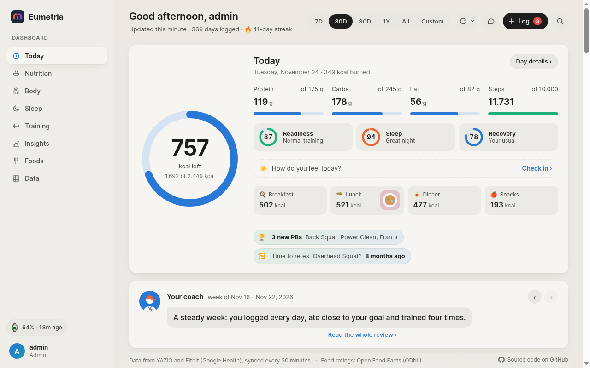

<p align="center"></p>

<h1 align="center">Eumetria</h1>

<p align="center"><b>Your nutrition, training and sleep in one self-hosted dashboard.</b></p>

<p align="center"><a href="https://eumetria-labs.github.io/eumetria/"><b>Documentation</b></a> · <a href="https://eumetria-labs.github.io/eumetria/start/quick-start/">Quick Start</a> · <a href="https://eumetria-labs.github.io/eumetria/install/server/">Install on a server</a> · <a href="https://discord.gg/dqJ7JPdsQ4">Discord</a></p>



## ✨ What is it?

Eumetria puts the data of the apps you already use onto one page on your own server. From [Yazio](https://www.yazio.com) it takes calories, macros, meals, foods, recipes, weight, steps and activities. Optionally it adds what a Fitbit or Pixel Watch records through the Google Health API: workouts with heart rate and route, sleep stages and overnight measurements. You log your trainings, personal bests, notes and a daily check-in on top, and Claude can write a weekly review, answer questions about your data and read whiteboard photos.

It runs as one small Docker container that serves the page and syncs on a timer. Everything is in the [documentation](https://eumetria-labs.github.io/eumetria/).

## 🚀 Quick Start

On your own computer, with Docker:

```sh
echo "SETTINGS_KEY=$(openssl rand -hex 32)" > eumetria.env
docker run -d --name eumetria -p 127.0.0.1:8080:8080 -v eumetria-data:/data \
  --env-file eumetria.env -e PUBLIC_URL=http://localhost:8080 \
  ghcr.io/eumetria-labs/eumetria:1
```

Open [http://localhost:8080](http://localhost:8080): it says there's no account yet. Create the first admin:

```sh
docker exec -it eumetria /eumetria -create-user admin -role admin
```

It asks for a password and prints an enrolment link. Open it, sign in, add a passkey or an authenticator app, then enter your Yazio account under **Settings → Yazio**. The [Quick Start](https://eumetria-labs.github.io/eumetria/start/quick-start/) walks through it with screenshots, and [Install on a server](https://eumetria-labs.github.io/eumetria/install/server/) sets it up for good with nginx and HTTPS.

Just looking? `docker run --rm -p 127.0.0.1:8080:8080 ghcr.io/eumetria-labs/eumetria:1 -demo -serve :8080` and sign in as `demo` / `demo`.

## 🛠️ Local development

```sh
# the page with sample data at http://localhost:8080, sign in as demo / demo
go run ./cmd/eumetria -demo -serve :8080 -site site -data /tmp/eumetria-demo

# tests
go vet ./... && go test ./...
node --test tests/*.test.js
go run ./cmd/eumetria -demo -out site/stats.json && node scripts/smoke.js site
```

More in [Local development](https://eumetria-labs.github.io/eumetria/project/development/). The docs live in [`docs/`](docs/).

## 💬 Community

Questions, ideas and setups: join the Discord.

[](https://discord.gg/dqJ7JPdsQ4)

## ⚠️ Unofficial API

This is a personal project. It is not affiliated with, endorsed by or supported by YAZIO. It uses YAZIO's private, undocumented API, which is subject to YAZIO's terms of service and can change or stop working at any time. "YAZIO" is a trademark of its owner and is used here only to say which service the tool works with. The endpoints come from community work, credited in [Unofficial API and credits](https://eumetria-labs.github.io/eumetria/project/disclaimer/). MIT-licensed, see [`LICENSE`](LICENSE).
