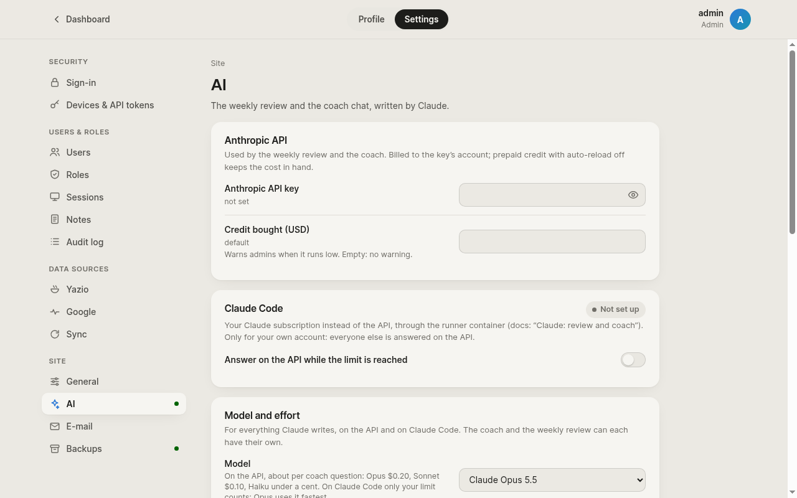

Three features use Claude, all optional and set up under **Settings → AI**:

- the **weekly review**: a short look back at each week;
- the **coach**: a chat about your data;
- **whiteboard photos**: a photo in a training note, written out as text (see [Notes](/eumetria/features/notes/#whiteboard-photos)).

They run on the **Anthropic API** (pay per use, with an API key) or on **Claude Code** with your own Claude subscription.

## The Anthropic API

1. Buy credit at [console.anthropic.com](https://console.anthropic.com) and create an API key. Leave auto-reload off, so nothing more can be charged.
2. Enter the key under **Settings → AI**, and the amount under **Credit bought**. The page warns admins when it covers fewer than four more reviews.
3. **Model and effort** applies to everything Claude writes (default Claude Opus 5.5, effort medium). The coach and the weekly review can each tick **Own model and effort**.

## Weekly review

The first sync after a calendar week has Claude write a short review of it: nutrition, training, sleep and recovery, compared with the week before, in English and German. It's written once per week and stored; about $0.10 a week with Opus. It appears on the Today card under **Your coach**.

- Claude sees all of the data to write it. Who may read it is up to the `view.review` permission.
- It knows your phases and events, check-ins, trainings and new bests, and judges calories against a cut or bulk.
- **Settings → AI** can write all reviews again, e.g. after a prompt change. That runs between syncs and shows how far it got.

## Coach

A chat on the dashboard: the speech-bubble button in the top bar. You ask about your data ("How did I sleep this week compared to last week?", "Where does my protein come from?") and Claude looks it up with read-only tools before it answers. The answer streams in, with a line for each lookup ("sleep · Nov 9 – Nov 20").

- Off by default: switch it on under **Settings → AI → Coach**.
- Only roles with **Ask the coach** (`use.coach`) can use it; admins always can. Claude sees only what the asker's role sees.
- On the API a question costs about $0.20 with Opus, $0.10 with Sonnet and under a cent with Haiku; admins see each answer's cost under it. Follow-up questions in the same chat cost less (the instructions and tools are cached), and send the last 10 questions and answers along.
- Chats belong to the person who asked, are kept in `app.db`, and can be deleted.
- No diagnoses, and the data is treated as data: text in food names or notes is never followed as an instruction.

:::note[nginx]
A server set up before the coach existed needs the `location /api/coach` block from [`deploy/nginx.conf`](https://github.com/eumetria-labs/eumetria/blob/main/deploy/nginx.conf). It allows questions up to 16 KB; nginx's default 1 KB would refuse longer ones.
:::

## Claude Code (your subscription)

Instead of the API, the coach, the weekly review and whiteboard photos can run on your own Claude subscription (Pro or Max). Answers then count against your subscription's limits instead of API credit. It runs the unmodified Claude Code CLI in a second container, `claude-runner`, so Eumetria never holds your Claude login.

- **Only your own account** uses it: the site's owner (the oldest admin). Anthropic's terms allow a subscription only for its subscriber's own use. Everyone else who may ask the coach is answered on the API, when a key is set.
- Each answer runs without Claude Code's built-in tools (no shell, files or web), only with Eumetria's read-only tools, through a token made for that one answer and deleted right after.
- When your 5-hour or weekly limit is reached, the coach says *Claude's limit is reached: your answer comes after 13:40* and answers by itself after the reset. The weekly review is written on the first sync after it. To use the API while the limit lasts, tick **Answer on the API while the limit is reached**.

Setting it up:

1. On any machine where you're signed in to Claude, run `claude setup-token`. It opens the browser and prints a token valid for a year.
2. Create `/srv/eumetria/claude-runner.env` (mode 600) from [`deploy/claude-runner.env.example`](https://github.com/eumetria-labs/eumetria/blob/main/deploy/claude-runner.env.example): the token as `CLAUDE_CODE_OAUTH_TOKEN`, and a random `RUNNER_KEY` (`openssl rand -hex 32`).
3. Add the same `RUNNER_KEY=` line to `eumetria.env`.
4. Add the `claude-runner` service from [`deploy/compose.yaml`](https://github.com/eumetria-labs/eumetria/blob/main/deploy/compose.yaml) to yours, then run `docker compose --profile claude up -d`. Without `--profile claude`, the runner isn't started.
5. **Settings → AI:** the Claude Code section should say **Ready**. Pick **Claude Code (your subscription)** for the coach, under **Weekly review → Written by** and for whiteboard photos.

The token expires after a year: run `claude setup-token` again and restart the runner. To switch back, pick **Anthropic API**; to remove the runner, `docker compose --profile claude down claude-runner`.
