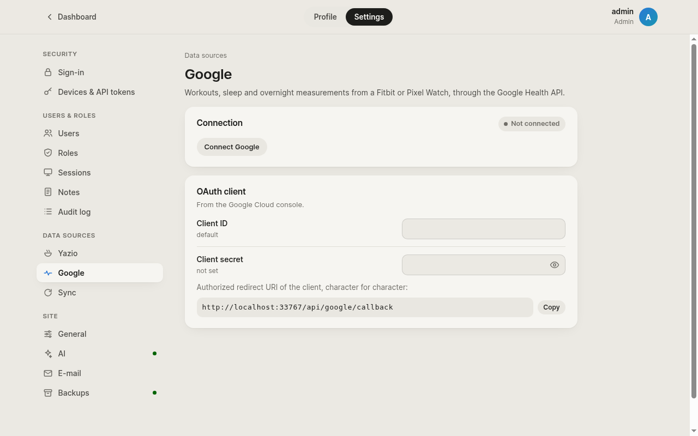

Optional. With a Fitbit or Pixel Watch, the page also shows workouts (heart rate by zone, splits, route, elevation), sleep stages, resting heart rate, HRV, breathing rate, blood oxygen, skin temperature, the calories Fitbit counts, active zone minutes and VO2 max. Eumetria computes its own [Sleep, Recovery and Readiness scores](/eumetria/features/body-sleep/#eumetrias-scores) from them.

The data comes through the [Google Health API](https://developers.google.com/health), with a Google Cloud project of your own. That's a one-time setup of about ten minutes.

## 1. A Google Cloud project

In the [Google Cloud console](https://console.cloud.google.com/):

1. Create a project and enable the **Google Health API**.
2. **Google Auth Platform → Branding:** an app name (without "Google" or "Fitbit"), your e-mail, and your domain under **Authorized domains**. No logo: a logo needs Google's verification.
3. **Audience → Publish app**, so the status says **In production**. In "Testing", Google's refresh tokens expire after 7 days.
4. **Clients → Create client → Web application**, with `https://eumetria.example.com/api/google/callback` as **Authorized redirect URI**, character for character. **Settings → Google** shows the exact address to use.

Google may warn that the app isn't verified when you connect. That's expected for an app only you use: continue past it.

## 2. Connect

Put the client ID and secret into **Settings → Google**, press **Connect Google** and allow every access.

The token is stored in `data/google-token.json`, and the next sync uses it. The first one fetches the history, including routes.

:::note[Google sign-in needs the real address]
Connecting goes through Google and back to `PUBLIC_URL`. On `http://localhost` it works with a redirect URI for `http://localhost:8080/api/google/callback` added to the same client.
:::

## When it stops working

If the log says `google: not authorized`, Google revoked the token: after a password change, when access was removed, or after six months unused. Press **Settings → Google → Connect again**.

## What isn't there

Scores computed in the Fitbit app (Readiness, Sleep Score, Cardio Load) aren't in the API, and Eumetria doesn't imitate them. It has [scores of its own](/eumetria/features/body-sleep/#eumetrias-scores) instead.
