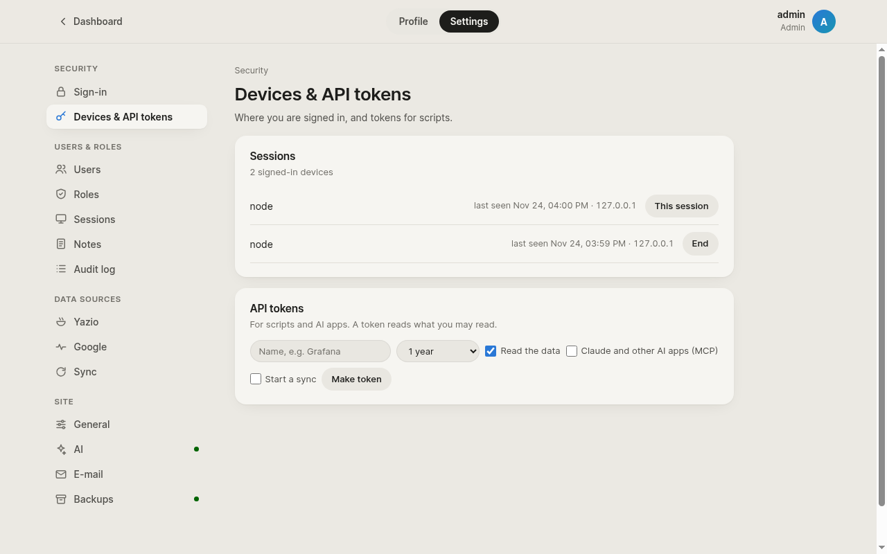

Eumetria is an [MCP](https://modelcontextprotocol.io) server at `https://eumetria.example.com/api/mcp`. An AI app connected to it can look your data up while it answers: "How did my sleep change since the cut started?", "Where does my sodium come from?", "Compare my squat sessions this month".

The tools are read-only: `overview`, `daily_metrics`, `entries`, `food_sources`, `workouts`, `sleep`, `body`, `checkins`, `lifts`, `sessions`, `wods` and `phases`.

## 1. nginx

A server set up before the MCP server existed needs the `location = /api/mcp` block from [`deploy/nginx.conf`](https://github.com/eumetria-labs/eumetria/blob/main/deploy/nginx.conf) (or `nginx-tls.conf`). Without it, nginx refuses MCP messages over 1 KB with a 413. Then `nginx -t && systemctl reload nginx`.

## 2. A token

Make a token with **Claude and other AI apps (MCP)** ticked under **Settings → Devices & API tokens**, or on the server:

```sh
docker compose run --rm eumetria -create-token <name> -token-name claude -scopes mcp
```



An `mcp` token works only on `/api/mcp`, not on the rest of the API, and shows what the account's role may see: a role without `view.foods` gets no food names, and without `view.health` no Fitbit tools.

## 3. Claude Code

```sh
claude mcp add --transport http --scope user eumetria https://eumetria.example.com/api/mcp \
  --header "Authorization: Bearer eum_…"
```

`claude mcp list` should then say `✔ Connected`. In a project's `.mcp.json` the entry is:

```json
{ "type": "http", "url": "https://eumetria.example.com/api/mcp", "headers": { "Authorization": "Bearer ${EUMETRIA_TOKEN}" } }
```

## claude.ai, Claude Desktop and the phone apps

These connect to remote servers through **Customize → Connectors** on claude.ai, which needs OAuth. Eumetria doesn't offer OAuth yet. Only if your account shows a **Request headers** field there (a beta Anthropic offers to some accounts) can you add `Authorization` with the value `Bearer eum_…`.

## Limits and privacy

Each tool call counts against the token (60 a minute) and is written to the audit log with its arguments, never with its result. Revoking the token cuts the app off at once. What the app does with the answers depends on the app; with Claude, your Claude plan's terms cover it.
