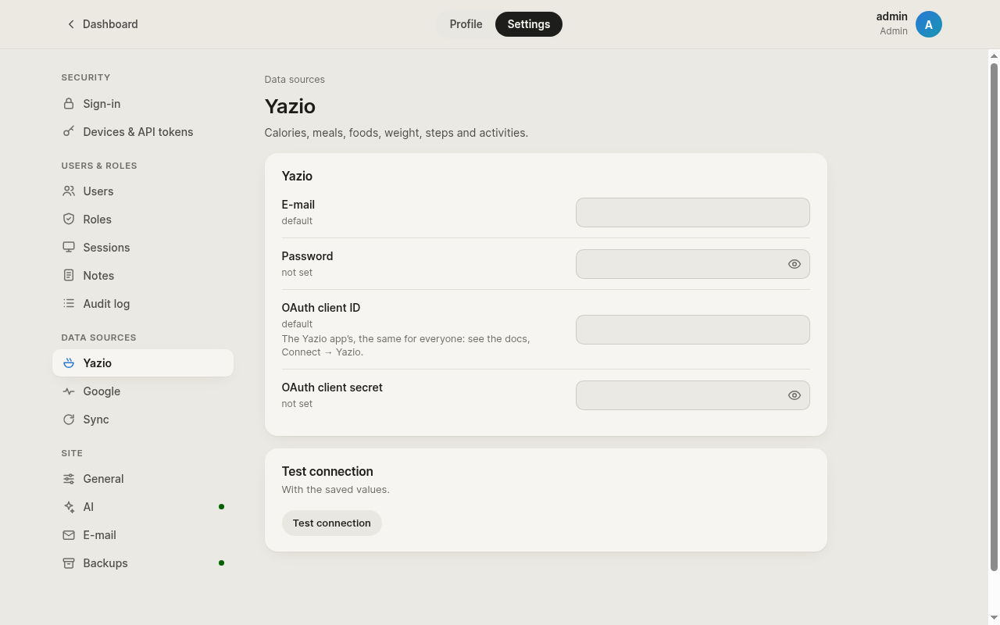

Yazio is Eumetria's main source: calories, macros, meals, foods, recipes, weight, steps and activities, with nutrients for most foods.

## Connect it

Under **Settings → Yazio**, enter:

- your Yazio **e-mail** and **password**;
- the Yazio app's **OAuth client ID** and **client secret**.

The OAuth client belongs to the Yazio app and is the same for everyone, but it belongs to YAZIO, so it isn't in Eumetria's repository. The pair that works with Yazio's API v22 is in the community's [yazio-api-specification](https://github.com/dornsebastian/yazio-api-specification) (`spec/components/schemas/OAuthTokenRequest.yaml`). If YAZIO changes it, update the settings; no new image is needed.

**Test connection** checks the saved values. Then save and press the sync button. The first sync fetches the history from **Settings → Sync → First day** (a year by default) and every meal photo, which takes a few minutes.

:::note
The password is stored encrypted with `SETTINGS_KEY`. Without that variable, the page can't save it; see [Configuration](/eumetria/install/configuration/).
:::

## How the sync works

- It runs on a timer (every 30 minutes by default, **Settings → Sync**) and when someone with the `sync` permission presses the button.
- Each sync fetches the last 3 days again, since they may still change, plus any days missing.
- Days you edit further back in the app reach the page only with **Full refresh**, in the sync button's menu.
- If no sync succeeds for three intervals in a row, `/healthz` turns unhealthy; point an uptime monitor at it (see [Maintenance](/eumetria/operations/maintenance/)).

## Nutrients

Yazio lists alcohol, fibre, minerals and vitamins for most products and recipes. Eumetria shows them in **Calories → Nutrients**, compared with the DGE/ÖGE/SGE reference values; see [Nutrition](/eumetria/features/nutrition/#nutrients). AI-logged entries carry no nutrients, so each value says how much of what you ate it covers.

:::caution[Unofficial API]
Eumetria uses YAZIO's private, undocumented API. It can change or stop working at any time; see [Unofficial API and credits](/eumetria/project/disclaimer/).
:::
