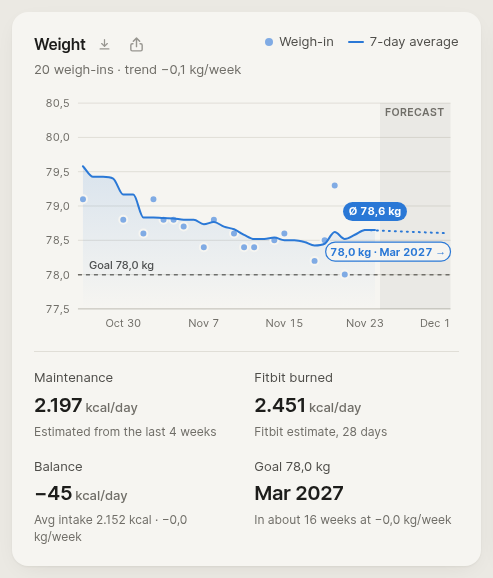
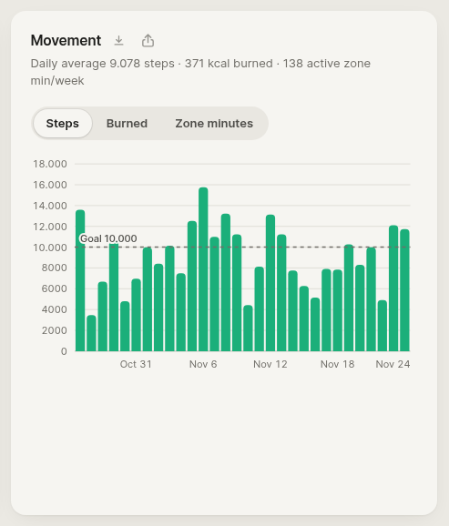
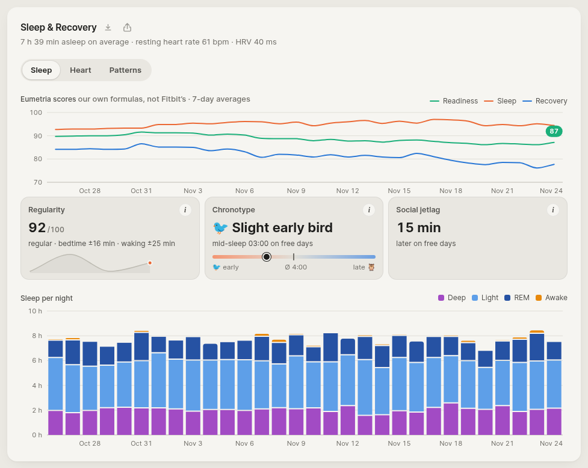

## Weight

The **Weight** card charts your Yazio weigh-ins with a 7-day trend, how far you are from your goal, and when you'd reach it at the current pace. It also estimates your maintenance calories from what you ate and how your weight moved.

## Movement

**Movement** has **Steps**, **Burned** and **Zone minutes** (with a Fitbit or Pixel Watch).

## Sleep and recovery

With a Fitbit or Pixel Watch, **Sleep & Recovery** has three tabs: **Sleep** (scores and stages), **Heart** (resting heart rate and HRV) and **Patterns** (how nights differ after alcohol, late meals, stressful days and the check-in's tags).

### Sleep timing

The Sleep tab opens with three numbers about *when* you sleep, for the range picked:

- **Regularity:** the Sleep Regularity Index (0–100: how likely you are asleep or awake at the same minute as 24 hours before, from the hypnograms; 80 or more is regular), with how much bedtime and wake time vary and its course week by week.
- **Chronotype:** the middle of your sleep on free nights, corrected for sleep caught up after the week (MSFsc), named on a five-step scale from clear early bird to clear night owl (adults lie around 4:00 on average).
- **Social jetlag:** how far that middle moves between work and free nights.

A free night is one before a day off: one of your usual weekdays off (**Profile → Sleep**, Saturday and Sunday unless you change them), a public holiday of your state (Germany's 16 states or Austria), a day of a **Vacation** phase, or a day tagged **Day off** in the check-in. The chronotype needs at least four free and four work nights in the range; nights tagged travel don't count.

## Eumetria's scores

Scores computed in the Fitbit app aren't in the API and aren't imitated. Eumetria has scores of its own, each from 0 to 100, with a breakdown in the day's Sleep tab:

- **Sleep:** duration against your sleep goal (50 points), time asleep in bed (15), deep and REM share (15), and how regular the night was compared with the last 14 (20).
- **Recovery:** HRV, resting and sleeping heart rate and breathing rate against your own last 30 days. A usual morning scores about 80, each usual swing better or worse about 10 points. It needs 14 days of data first. A skin temperature clearly above Fitbit's baseline caps it at 60 and says so.
- **Readiness:** half Recovery, 30 % Sleep, 20 % training load. 90 and up: ready for a hard session; below 75: take it easy.

Days tagged **sick** or **travel** in the check-in stay out of the baselines Recovery compares with, so a cold doesn't shift what counts as usual afterwards.

The sleep goal is under **Profile → Sleep** of the site's owner (the oldest admin, whose watch it is; 8 hours by default). The formulas are in [`internal/scores`](https://github.com/eumetria-labs/eumetria/blob/main/internal/scores/scores.go).
