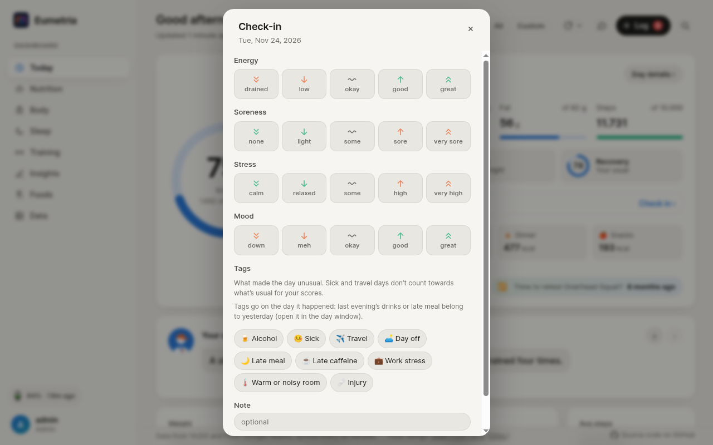
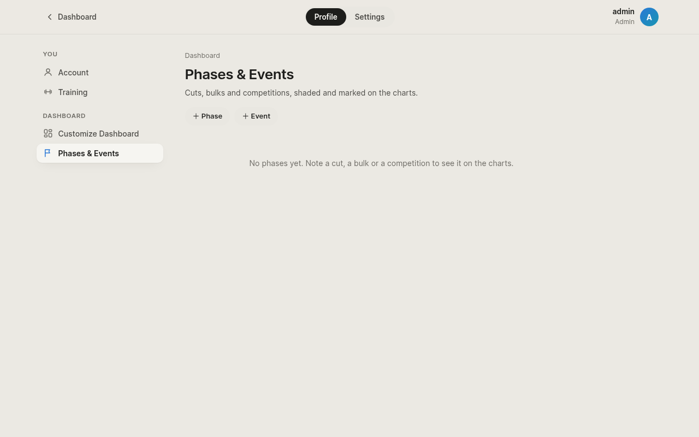

## Check-in

Once a day, the Today card asks *How do you feel today?*: energy, soreness, stress and mood, each on five steps from much less to much more (⇊ ↓ ∼ ↑ ⇈, green where it's good for you and orange where it isn't), each optional, plus a short note and tags that explain an unusual day: alcohol, sick, travel, late meal, late caffeine, work stress, a warm or noisy room, injury, day off.

- Afterwards the card shows it in one line ("↑ Energy · ↓ Soreness · ✈️ Travel").
- Before noon the form can still switch to yesterday; the day window shows and changes any day's. **+ Log → Check-in** opens it too.
- A day with 10 g of alcohol or more in the foods logged is tagged by itself; untick it and it stays away.
- Check-ins don't change the scores, but days tagged **sick** or **travel** stay out of the baselines Recovery compares with. On a sick day, Readiness says *Sick: rest first*.
- The charts band sick and travel days, **Patterns** compares nights after each tag with nights without it, the printable report averages the answers and counts the tags, the export has a `checkins` table, and the weekly review sees them.

`view.health` reads check-ins; `edit.checkin` writes them (with a second factor).

## Phases and events

**Profile → Phases & Events** notes a stretch of days with a purpose (**Cut**, **Bulk**, **Maintain**, **Vacation** or your own, with an optional name; leave the end empty while it runs) and one-day events such as a competition, also ahead. **+ Log → Phase or event** adds one too.

- The weight, calorie, macro, score and training load charts shade the phases and mark events with 🏁; a chart's tooltip names them.
- Each phase gets a summary: its days, the weight change (7-day average in the first week against the last), average calories and protein on logged days, and training days per week.
- A line under the Today card's title shows the running phase ("Maintain · day 71") and the next event within 90 days.
- The weekly review judges calories and weight against a cut or bulk and mentions an event ahead. The printable report lists them, and the export has a `phases` table.
- **Insights → Goals** counts calories against the phase: at or below the goal in a cut, at or above in a bulk.

Whoever sees nutrition or health data sees them; `edit.lifts` writes them.
