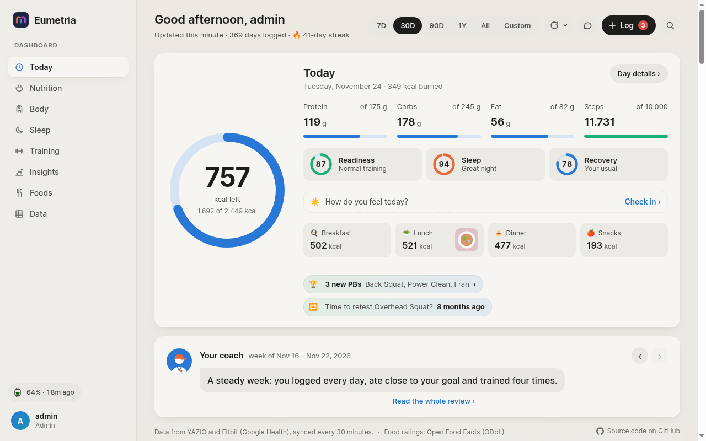
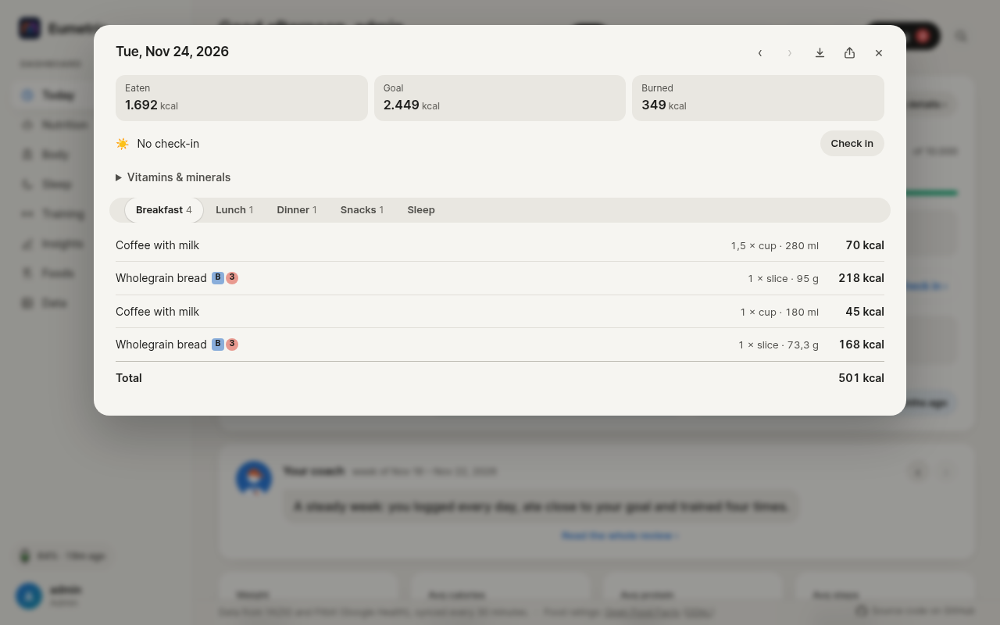
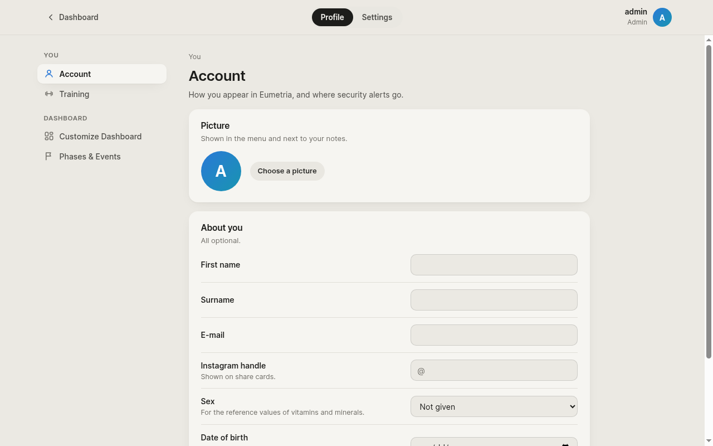
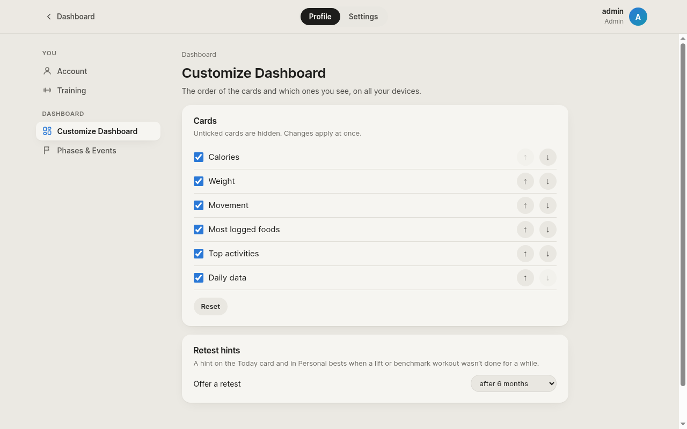

## Layout

On a wide screen a sidebar lists the parts of the page (**Today, Nutrition, Body, Sleep, Training, Insights, Foods, Data**), with the one in view marked, your watch's battery and you at its foot. Between 900 and 1100 px wide it keeps only the icons. The cards are grouped under the same names, in the order you chose; two half-width cards next to each other (Weight, Movement, Most logged foods, Top activities) share a row.

On a phone, a tab bar at the bottom shows one part at a time; see [On your phone](/eumetria/features/phone/).

At the top: the greeting and when the data was last synced, the **range** (7, 30 or 90 days, a year, everything, or your own dates), **sync** with **Full refresh** in its menu, the **coach**, **+ Log** and **search** (Ctrl+K).

Card tabs remember the one you picked. Every chart's legend switches its lines on and off with a tap (one always stays on), remembered per chart on this device. Each tile explains itself behind an ⓘ.

## + Log

**+ Log** logs a **Training**, a **Check-in**, or a **Phase or event**, for whoever may write them. A red count on it means recorded workouts that aren't logged yet; see [Trainings](/eumetria/features/trainings/#not-logged-yet).

## The day window

**Day details** on the Today card, a day in a chart or calendar, or a search result opens the day: what you ate, by meal, with each food's amount and calories, the day's activities and workouts, the night's sleep, nutrients, the check-in and the bests noted that day.

## Account menu, Profile and Settings

Your avatar opens a short menu: **Profile**, **Settings**, the style (light, dark or **Auto**, as your device), the language (English or German) and **Sign out**, which asks whether to sign out on this device or everywhere.

Profile and Settings open one page with a switch between the two: a sidebar of sections on a wide screen, a list to tap through on a phone.

**Profile → Account** holds a picture (shown in the menu and next to your notes), your name, e-mail and Instagram handle, and your sex and date of birth (for the nutrients' reference values, and a greeting on your birthday). All of it is optional, and only the picture is visible to others.

## Customize Dashboard

**Profile → Customize Dashboard** sets the order of the cards and hides the ones you don't need. It's stored with your account, so it's the same on every device; **Reset** brings back the page's own order. The same page sets the **retest hints** (see [Personal bests](/eumetria/features/personal-bests/#retest-hints)).

## Search

The magnifying glass, or Ctrl+K, searches your whole history: foods, activities, days, lifts, benchmark workouts and notes. A food or activity opens its history across all days.

## Links

Links can open a view: `#range=7|30|90|365|all`, `day=YYYY-MM-DD`, `tab=breakfast|lunch|dinner|snack|activities|sleep`, `workout=<id>`, `food=<name>`, `activity=<name>` and `year=2026`, e.g. `#range=30&day=2026-10-13&tab=sleep`.
