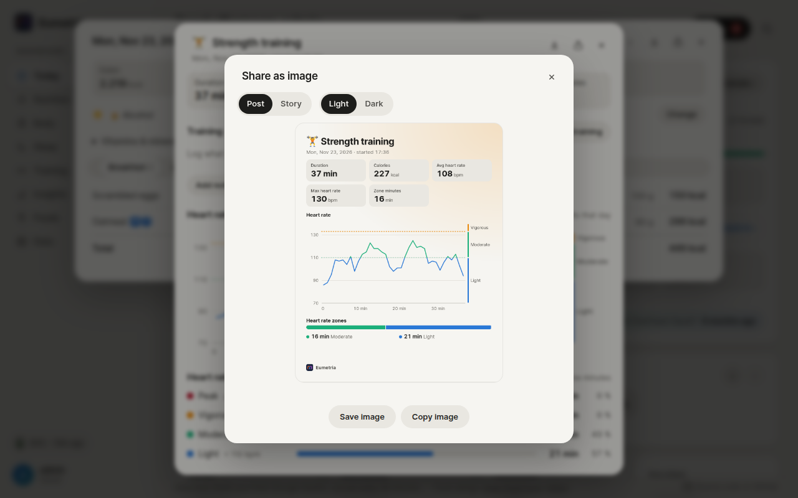

## Export

The **Daily data** card (under **Data**) has the export: pick the days, then **CSV** or **JSON**. It downloads a ZIP with one table per kind of data:

- days, foods, recipes, activities, workouts, sleep (with mid-sleep and free or work night), sleep timing, nutrients;
- goal changes and weekly reviews;
- what people wrote: workout notes, lifts, benchmark workouts and results, trainings and their sets, check-ins and phases.

GPS routes and photos are left out. Each table holds only what your role may see.

The card itself is every value on the page as a table: select a date for its details, a column to sort by it.

## Printable report

**Print report**, next to the export, makes an A4 report of the same days, with the key numbers, the scores, charts and tables, training (work sets and volume), check-ins and phases. Print it or save it as PDF from the browser's print dialog.

## Share pictures

Most windows have two buttons at the top: **save** the picture at once (in the format you picked last) and **share**, which opens the share window: post (4:5) or story (9:16), light or dark.

There are pictures of a meal, a recipe, a day, a workout, a night's sleep, the weight chart, a lift, a benchmark workout, the day's bests and the year in review. Nothing is uploaded: the picture is drawn in your browser from the data the page already has.

- A workout with a route can show it (**Show route**).
- **Include note** makes a second picture: the workout's name, date and numbers, then the whole note (text only) in the largest size that fits. **Both · Workout · Note**, or a tap on a picture, picks what Share, Save and Copy use.
- On a phone, **Share** opens the phone's share sheet (WhatsApp, Instagram, Signal, …).
