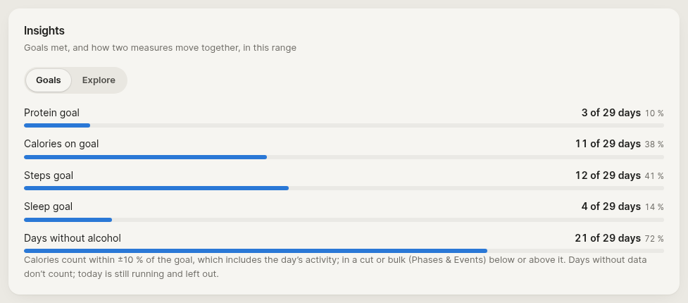
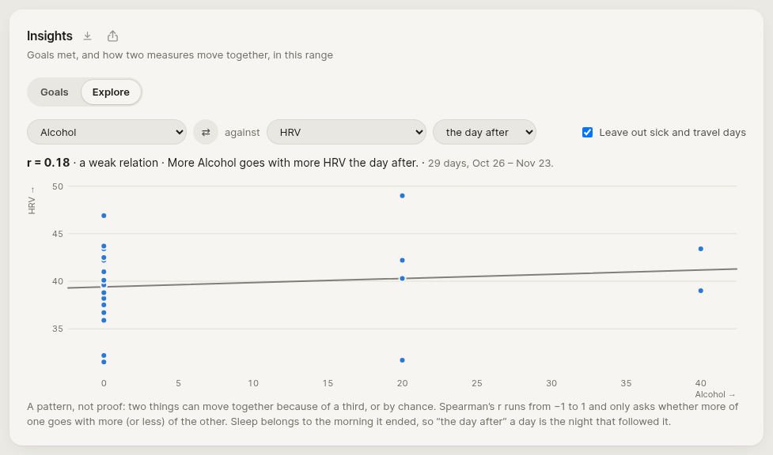

The **Insights** card has two tabs, both for the range picked.

## Goals

How often each goal was met:

- **Protein** at or above its goal.
- **Calories** by phase: in a cut at or below the goal, in a bulk at or above it, otherwise within ±10 % (the goal including the day's activity).
- **Steps** and the **sleep goal**.
- **Days without alcohol**, once alcohol was ever logged.

Days without data don't count, today is left out, and there are no streaks. The weekly review gets the same counts for its week.

## Explore

Pick any two daily measures from nutrition (macros, alcohol, fibre, sodium, magnesium), movement and training load, sleep (duration, deep, REM, bedtime, wake time, mid-sleep), recovery, the scores, the check-in and the weight trend. Then pick when the second one is read: the same day, the day after or two days after. Sleep belongs to the morning it ended, so "the day after" a day is the night that followed.

A scatter plot shows one dot per day with a trend line, Spearman's r (−1 to 1, in words from "no relation" to "strong"), the number of days and the period. Hover a dot for its values; click it to open the day. Sick and travel days can be left out.

It needs at least 10 days with both, and says plainly that it shows a pattern, not proof. The **Patterns** tab of Sleep & Recovery links to it.
