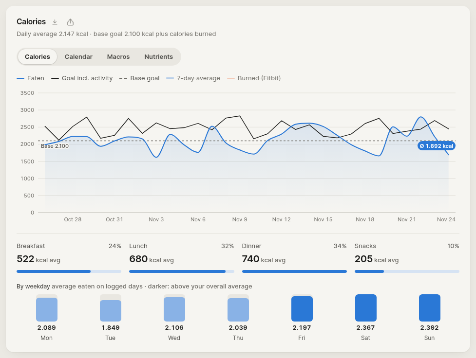
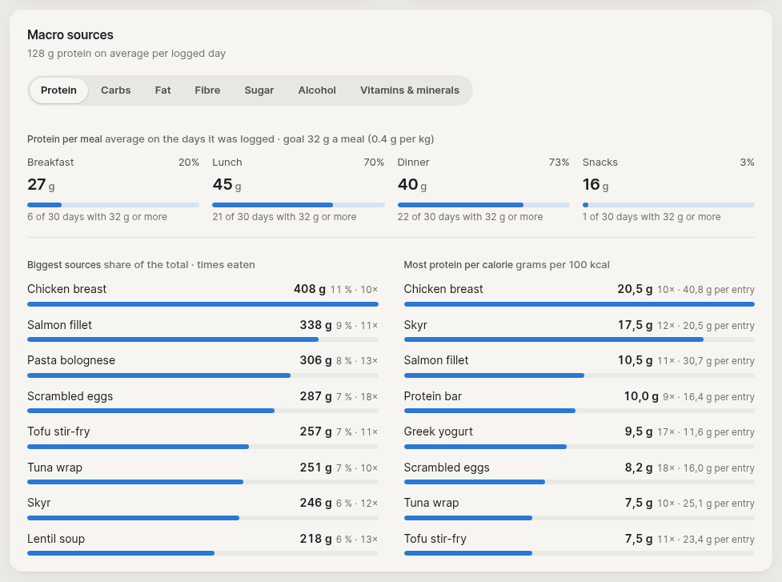
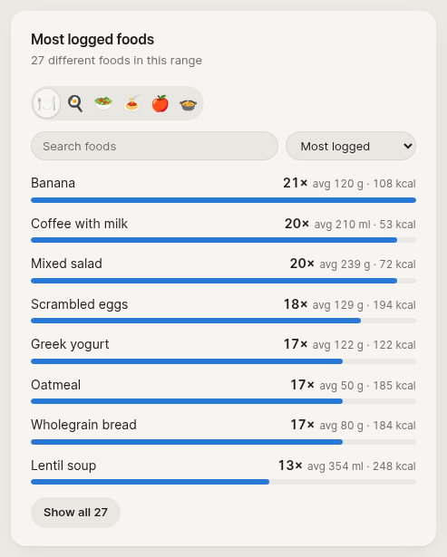

Everything here comes from what you log in Yazio.

## Calories

The **Calories** card charts what you ate against your goal including the day's activity and your base goal; the 7-day average and the calories Fitbit counts as burned are a tap away in the legend. Below the chart: your average per meal, and by weekday (darker: above your overall average).

Its tabs:

- **Calendar**: each day's intake against its goal, as a heatmap.
- **Macros**: protein, carbs and fat over time and as shares, and **training vs rest days**: calories and macros on days with a workout, a Yazio activity or a noted result, against days without, next to protein per kg split the same way.
- **Nutrients**: see below.

## Macro sources

**Macro sources** ranks the foods that bring the most protein, carbs, fat, fibre and more over the range. **Protein per meal** shows each meal's protein against 0.4 g per kg of bodyweight (30 g without a weigh-in). The **Alcohol** and **Vitamins & minerals** tabs do the same for those.

## Nutrients

Yazio lists alcohol, fibre, minerals and vitamins for most products and recipes. **Calories → Nutrients** shows the range's average per day: alcohol (grams, its kcal, days without, days with 10 g or more), then sodium, potassium, magnesium, calcium, iron, zinc, iodine, vitamins A, B12, C, D, E, folate and fibre.

- Not every food lists every nutrient, and AI-logged entries list none, so each value says how much of the calories eaten it covers. Below half, it's greyed out.
- With your sex and date of birth under **Profile → Account**, each value is compared with the daily reference values of the German, Austrian and Swiss nutrition societies (DGE/ÖGE/SGE, as published in 2025): as a reference, not a goal. Zinc assumes a medium phytate intake, sodium comes from the salt where only that is listed, and alcohol has no reference (the DGE names no safe amount).
- The weekly review compares with the reference values of the site's owner (the oldest admin).
- The day window lists the day's values; Patterns compares nights after 10 g of alcohol or more with nights after none.

## Foods

**Most logged foods** lists what you ate most, by meal, with Nutri-Score and NOVA badges from Open Food Facts where it knows the product, and your recipes. A food opens its history: how often, how much, and when.

