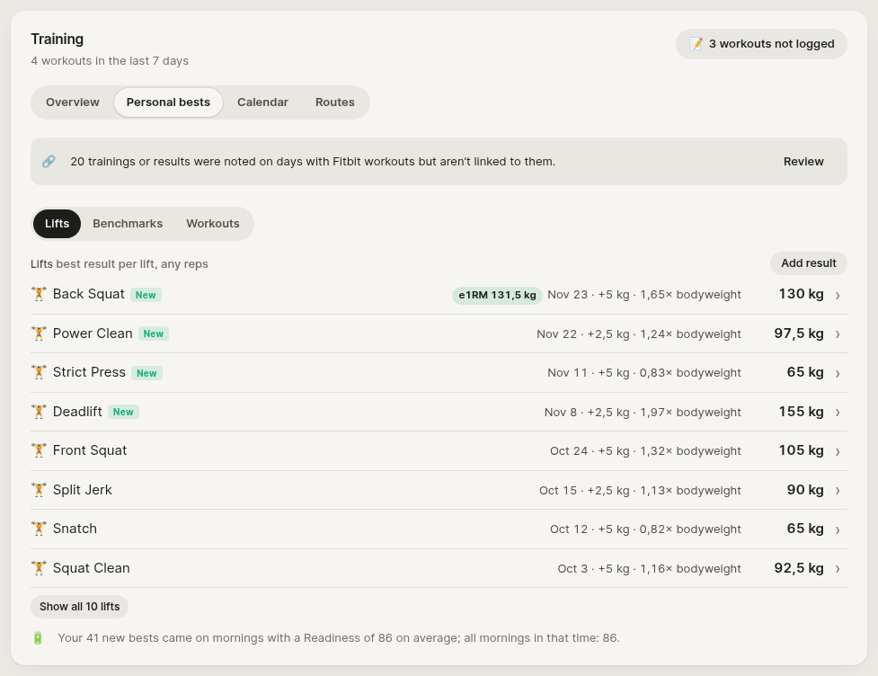
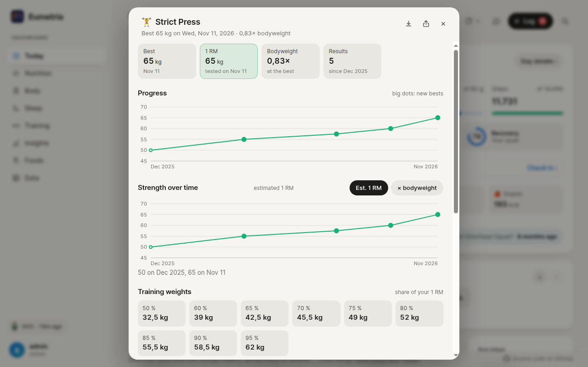
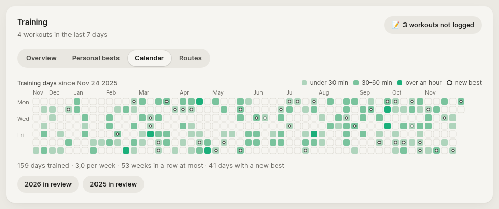
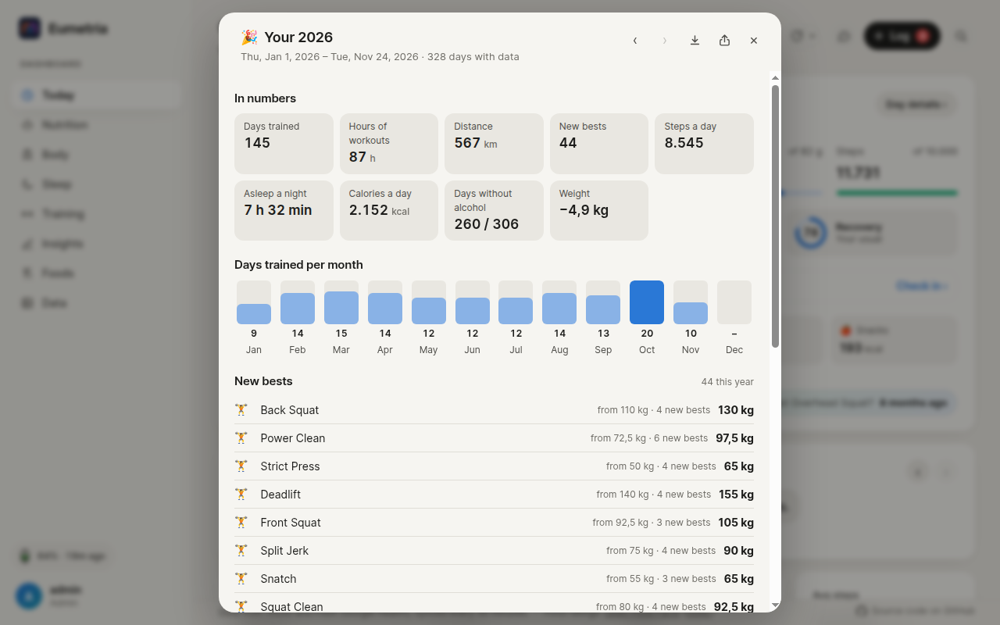

The Training card's **Personal bests** tab shows one part at a time: **Lifts · Benchmarks · Workouts** (records of your recorded workouts, all time). The switch remembers your pick. A list longer than 8 rows shows the most recent bests and **Show all**; from 13 rows on, a box above it filters by name.

## Lifts

You note results in lifts such as Power Clean, Strict Press or Split Jerk: weight, reps (1 for a one-rep max), date and an optional note, with **Add result**, or as sets in a [training](/eumetria/features/trainings/).

- Each lift has one best, whatever the reps: its heaviest result, and at the same weight the one with more reps (2 × 50 kg beats 1 × 50 kg; 5 × 48 kg doesn't), with the gain over the one before.
- The list shows an **e1RM** pill for a best of several reps.

A lift's window:

- **Tiles:** the best, the **1 RM** (highlighted: tested when a single is the top value, else estimated with Epley's formula from the result that gives the most, e.g. "from 3 × 90 kg"), the bodyweight multiple and the number of results.
- **Progress:** every result, one line per rep count, new bests bigger.
- **Rep maxes:** the heaviest result per rep count.
- **Strength over time:** the estimated 1 RM with every rep count and the work sets of trainings in it, or as a multiple of your bodyweight that week (from the Yazio weigh-ins).
- **Training weights** from 50 to 95 % of that 1 RM; picking one shows the **plates** for each side of a 20, 15 or 10 kg bar.
- **History:** every result, with its gain, bodyweight multiple, that morning's Readiness, and a link to the training it was done in.

## Benchmark workouts

**New workout** creates a workout you do again and again: a famous one like Fran, Cindy or Murph (typing its name fills in the rest) or one your box repeats. It has a name, how it's scored (for time, rounds and reps, reps or weight) and the workout as written. Each result gets a date, an optional note and **Scaled** when you did it lighter or easier, which keeps its own best.

A workout for time can have a time cap: a result that didn't finish is noted as the reps done and ranks below every finished time. How a workout is scored can't change once it has results. Its window charts the results (faster is up for times).

## Linking results to workouts

A result can belong to the training it was done in (see [Trainings](/eumetria/features/trainings/)). Results noted before they were linked show up as a notice in this tab: **Review** lists them, a day with one workout ticked already, a day with several asking which.

## Bests elsewhere

- A lift or workout whose best got better in the last 7 days shows as a chip on the Today card; several share one chip ("🏆 3 new PBs") that opens this tab.
- On a morning whose Readiness is 90 or more, the Today card says **⚡ Go for a PB**.
- This tab compares the mornings of your new bests with every morning in that time ("Your 41 new bests came on mornings with a Readiness of 86 on average").
- The weekly review mentions the week's new bests; the export has `lifts`, `benchmark_results` and `benchmark_workouts` tables.

## Retest hints

A lift or benchmark workout without a result for six months gets a **Retest?** mark here and a chip on the Today card ("Time to retest Overhead Squat? 8 months ago"). **Profile → Customize Dashboard → Retest hints** sets the months (3 to 24) or turns it off.

## Calendar and year in review

The Training card's **Calendar** shows the last year with every day trained, darker the longer the workouts of your training types were (Profile → Training; all but walks unless set); a day with a noted result counts too, and a dot marks a new best. Below it: days trained, per week, the longest run of weeks with training, and days with a new best.

Under it, **2026 in review** opens the year in review: days trained (per month too), hours, distance, the new bests with where each lift started the year, steps, sleep, weight and the foods eaten most often, each only with the data your role sees. In December and January the Today card offers it too, and `#year=2026` opens it from a link. It can be shared as a picture.

Lifts and benchmark workouts need `view.health` to read and `edit.lifts` to write.
