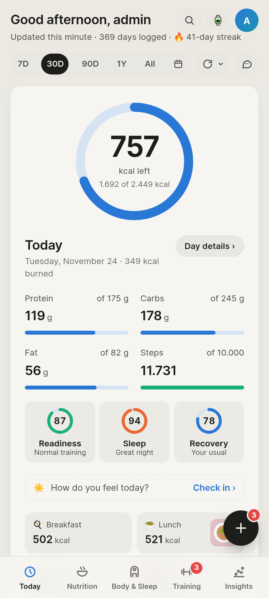
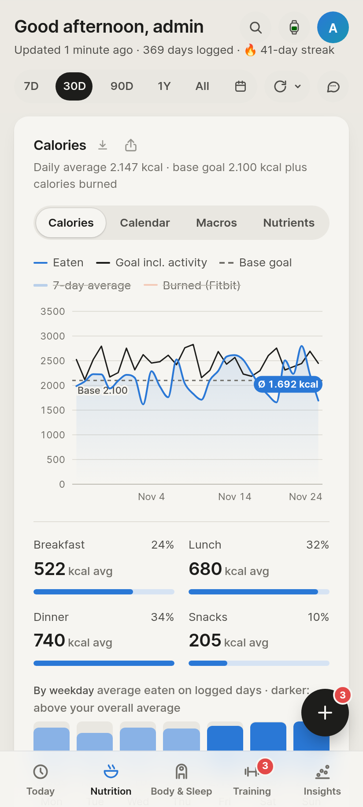
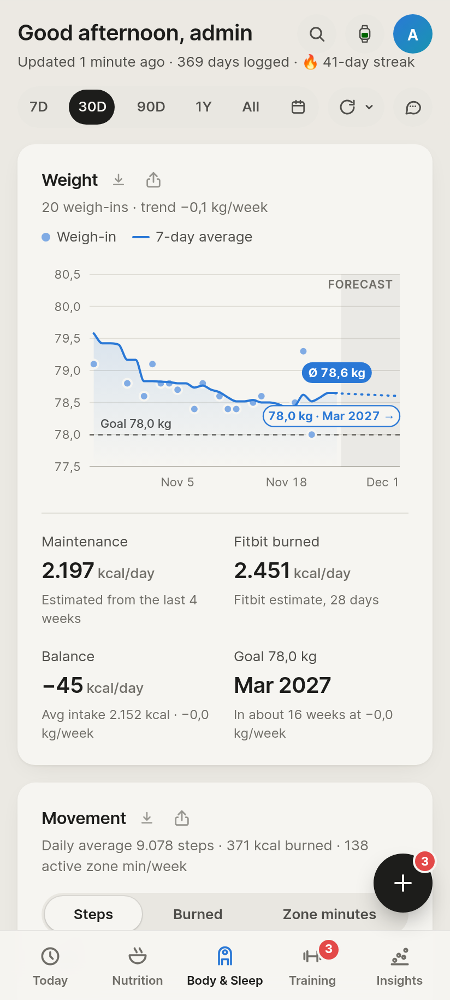
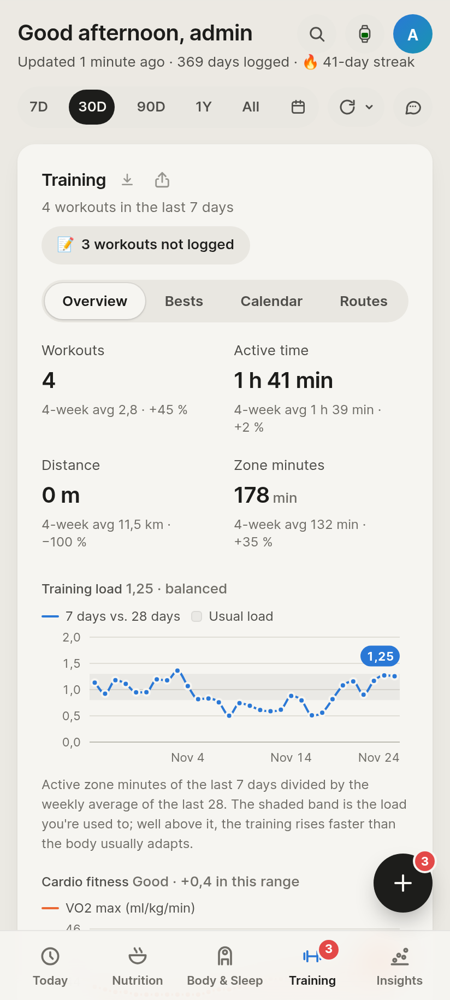
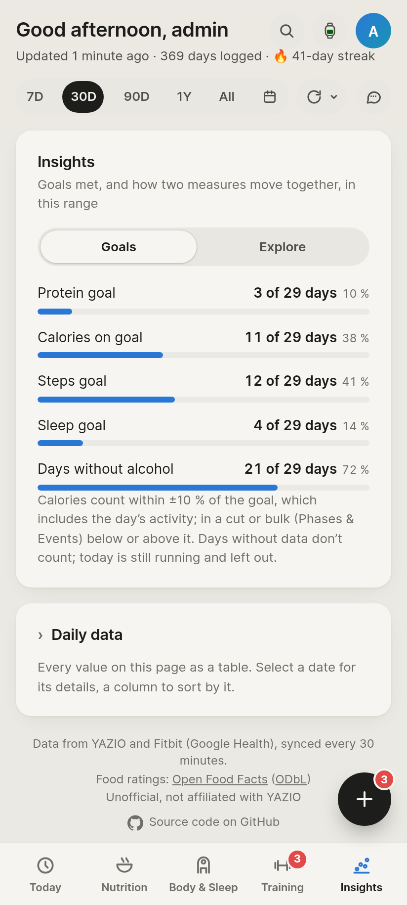

Eumetria is made for phones too, and tested at 412 and 360 px wide.

## Layout

- A **tab bar** at the bottom shows one part at a time: **Today, Nutrition, Body & Sleep, Training** and **Insights** (the Insights and Daily data cards).
- **Search**, your watch and your picture sit at the top right; Profile and Settings are behind your picture.
- The round **+** above the tab bar logs a training, a check-in, or a phase or event. A red count on it, and on the Training tab, means workouts not logged yet.
- Windows open as sheets from the bottom; in forms, Save and Cancel stay at the bottom while you scroll.
- The year in review is in **Training → Calendar**.

## Install it

In Chrome on Android, open the menu and pick **Install app** (or **Add to Home screen**); in Safari on iPhone, **Share → Add to Home Screen**. It then opens in its own window with its own icon.

**Offline:** sign in with **Keep me signed in on this device**, and the page keeps your data for offline use. Without it, nothing of your data is stored in the browser. Signing out deletes what was kept.

## App shortcuts

On Android, long-press the Eumetria icon for **Log training** and **Check-in**.

## Share a photo

On Android, the installed app appears in the share sheet for images. Share a whiteboard photo from the camera or gallery to Eumetria, pick which training it belongs to (today's recorded workout, a training already logged, or one without a recorded workout), and the photo is already in that training's note, ready for **Read the whiteboard**.

- The photo goes from the app's service worker straight to the page; nothing is uploaded before you pick the training. It's deleted from that storage as soon as the page takes it, and on sign-out.
- You need to be signed in; otherwise the photo is dropped and you share it again after signing in.
- After an update, Android may take up to a day to notice new shortcuts or the share target. Reinstalling the app from Chrome picks them up at once.
