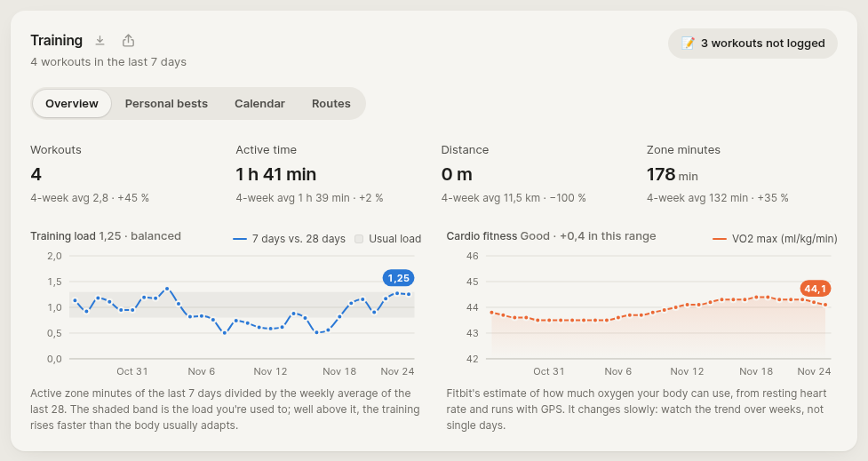
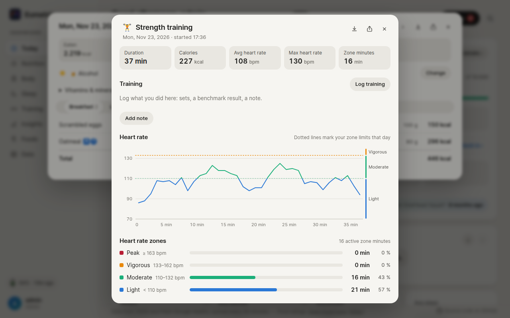
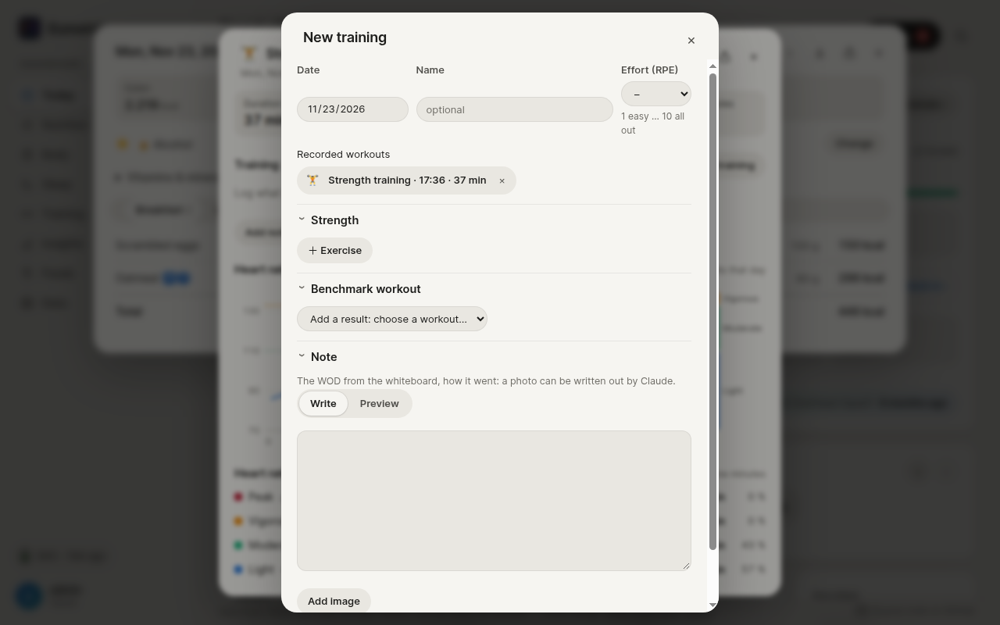
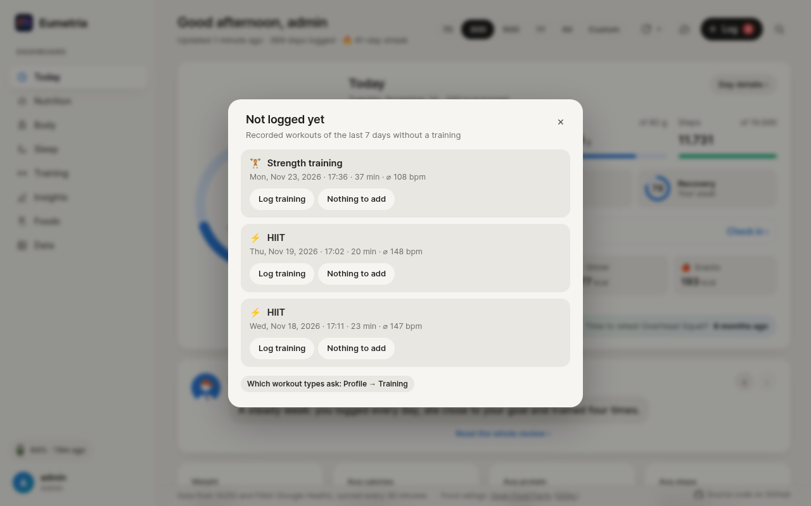
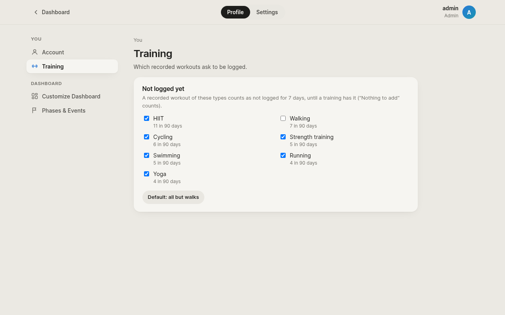

A **training** is one entry per workout: everything you log about a class or session goes into it, saved with one button. Sets are optional, so Eumetria stays a tracker rather than a training app.

## One training per workout

What you note for a recorded workout (its note, lifts, benchmark results and sets) belongs to that workout's training, so it all shows together in the workout's window. A training can wrap more than one device workout (an auto-detected warm-up run and the "Weights" of the same class), and one without a workout is fine too.

Daily WODs that change every class go in the note, with a whiteboard photo Claude can write out ([Notes](/eumetria/features/notes/)), not into benchmark workouts.

## Logging

- **+ Log → Training** lists today's recorded workouts that no training has yet (the newest first), today's trainings to change, and **Without a recorded workout**. With just one candidate, the form opens straight away.
- A workout's window has **Log training** or **Edit training**, and says when the workout is *part of a training with* another one.

## The Training form

- The date, a name and the effort (RPE 1–10).
- The **recorded workouts** as chips: × takes one out, **Add a workout of that day** adds one no other training has (walks last). With workouts, the date is theirs.
- **Strength:** the lifts noted in it, and exercises. Each exercise is a lift (names from your lifts, earlier sessions and the common ones) with sets of reps × kg; **W** marks a warm-up, 0 kg is bodyweight. **+ Set** copies the last set, **Repeat last time** fills in the sets of the last session with that lift.
- **Benchmark workout:** the results noted in it (✎ changes one), and a result to add: pick the workout or create one, then the time, rounds, reps or weight as it's scored.
- **Note** (for roles that may write notes): Markdown with images and **Read the whiteboard**.

**Save** saves the training, then the new result, then the note (an emptied note is deleted). If a later part fails, the form stays open and says so; saving again finishes it. On a phone, Save and Cancel stay at the bottom of the form while it scrolls.

A work set that beats the lift's best (heavier, or as heavy for more reps) is offered as **Save as PB?**, ticked; saving adds the best, linked to the training. **Delete** removes the training with its sets and note; its lifts and benchmark results stay, unlinked, and its workouts can be logged again.

## Not logged yet

A recorded workout of the last 7 days that no training has counts as **not logged**: a red count on **+ Log**, on the phone's Training tab, and as "3 workouts not logged" in the Training card's head. That opens a window with one row per workout:

- **Log training** opens the form with the workout attached.
- **Add to…** adds it to a training of the same day, for a workout recorded in two parts.
- **Nothing to add** saves an empty training, so the workout counts as reviewed on every device.

**Profile → Training** picks which workout types ask, from those recorded in the last 90 days: by default all but walks, and with none ticked nothing is counted. The same types decide what counts as a day trained in the Training calendar, the report and the year in review (a logged training or noted result always counts).

## Linked later

A training logged without a workout, on a day that now has one no training has (the watch synced later), is offered in the **Personal bests** tab's link notice, along with lifts and results not linked to a workout.

## Where trainings show

- The workout window shows a training's sets, lifts, results and note.
- The lift window shows the **Last sessions** with that lift, and its strength over time uses the work sets.
- The calendar counts training days; the weekly review gets the week's sessions; the printable report counts work sets and volume; the year in review counts the work sets.
- `view.health` reads trainings, `edit.lifts` writes them.

## Overview tab

The Training card's **Overview** compares the last 7 days (workouts, active time, distance, zone minutes) with the 4-week average, and charts the **training load** (zone minutes of the last 7 days against the last 28) and **VO2 max** with Fitbit's rating. **Routes** shows every GPS route of the range on one map.
