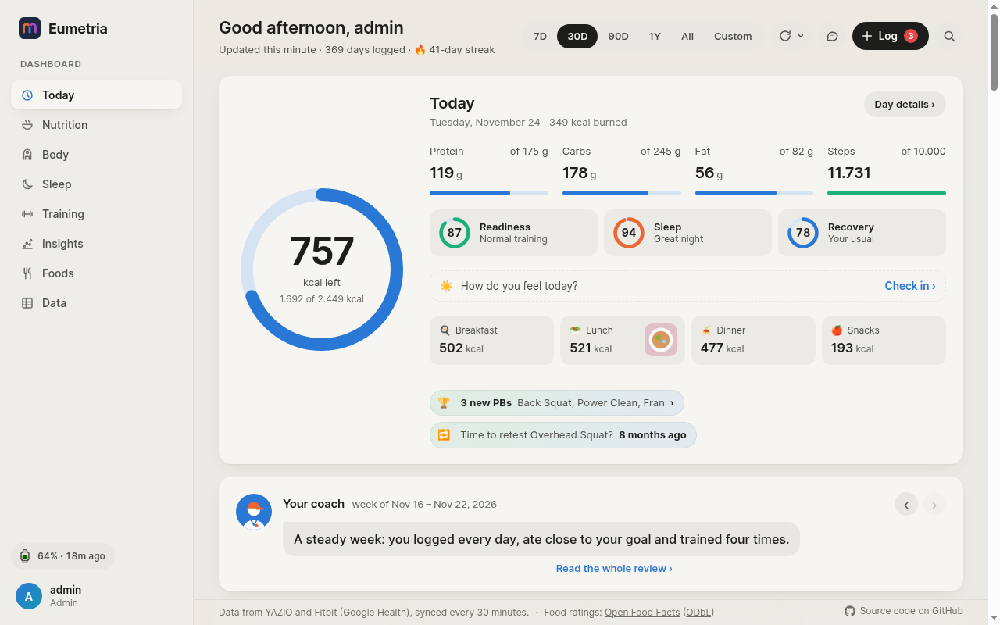

import { Card, CardGrid } from '@astrojs/starlight/components';

## What it does

Eumetria puts the data of the apps you already use onto one page on your own server. From [Yazio](https://www.yazio.com) it takes calories, macros, meals, foods, recipes, weight, steps and activities. Optionally it adds what a Fitbit or Pixel Watch records through the Google Health API: workouts with heart rate and route, sleep stages and overnight measurements. It runs as one small Docker container that serves the page and syncs on a timer.

<CardGrid>
	<Card title="Nutrition" icon="star">
		Calories, macros and their sources, protein per meal, alcohol, fibre, vitamins and minerals against the DGE reference values.
	</Card>
	<Card title="Body and sleep" icon="moon">
		Weight with a forecast to your goal, sleep stages, sleep timing, and Eumetria's own Sleep, Recovery and Readiness scores.
	</Card>
	<Card title="Training" icon="rocket">
		One training per workout: sets, personal bests, benchmark workouts and notes, with whiteboard photos read by Claude.
	</Card>
	<Card title="Insights and Claude" icon="comment-alt">
		Goal hit rates, a pattern explorer, an optional weekly review and coach chat by Claude, and an MCP server for Claude Code.
	</Card>
	<Card title="Yours" icon="seti:lock">
		Self-hosted, accounts with roles and second factors, backups (encrypted to Google Drive if you like), export as CSV or JSON.
	</Card>
	<Card title="On your phone" icon="phone">
		Installable, works offline, shortcuts on the app icon, and photos shared from the camera straight into a training.
	</Card>
</CardGrid>

:::caution[Unofficial]
Eumetria is a personal project, not affiliated with YAZIO. It uses YAZIO's private, undocumented API, which can change or stop working at any time. See [Unofficial API and credits](/eumetria/project/disclaimer/).
:::
