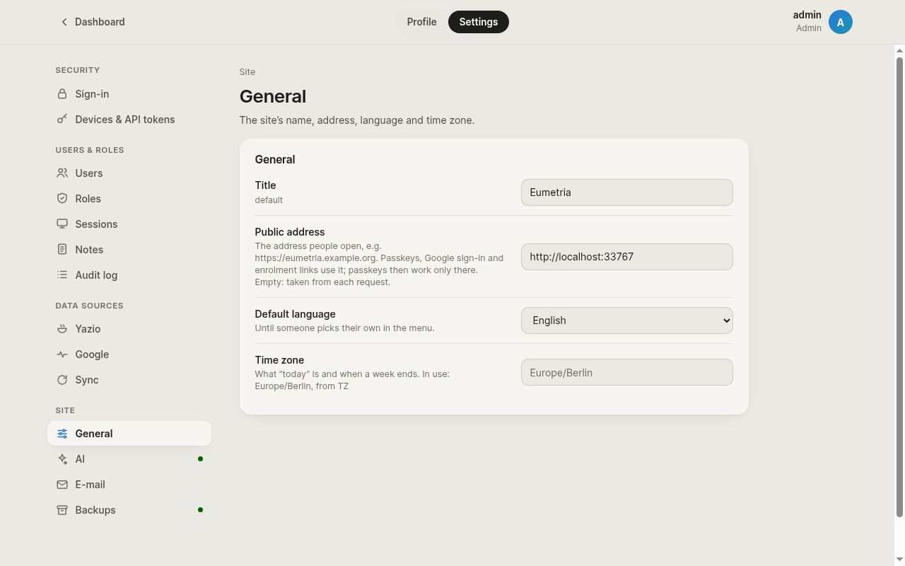

Almost everything is set in the page, under your avatar → **Settings**, and applies as soon as it's saved. Only what the server needs before anyone can sign in, or what shouldn't live in its database, comes from the environment (`eumetria.env` with Docker Compose, `-e` with `docker run`).

## Environment variables

| Setting | Default | Meaning |
|---|---|---|
| `SETTINGS_KEY` | – | Encrypts the secrets in the settings (passwords, API keys) and the authenticator apps' secrets. Make it with `openssl rand -hex 32` and **keep a copy outside the server**: it isn't in the backups, and that's the point. Without it, the settings' secrets have to be typed in again and authenticator apps stop working (use `-reset-second-factors`, then set them up again). Without the variable, secrets can't be saved in the page at all, and the apps' secrets are kept unencrypted. |
| `TZ` | `UTC` | The default time zone, e.g. `Europe/Berlin`. **Settings → General** can change it. |
| `PUBLIC_URL` | – | The site's address, e.g. `https://eumetria.example.com`; also under **Settings → General**. Passkeys, Google sign-in, enrolment links and links in mails use it. Without it, they take the address from each request. |
| `TRUSTED_PROXY` | – | nginx's address as the container sees it: `172.30.90.1` with the network in `deploy/compose.yaml`. Only its `X-Real-IP` header counts for rate limits and the audit log. Without it, any private address's does. Check with `docker inspect eumetria -f '{{range .NetworkSettings.Networks}}{{.Gateway}}{{end}}'`; a wrong value shows as a warning in the log. |
| `RUNNER_KEY` | – | Shared with the optional `claude-runner` container; see [Claude Code](/eumetria/connect/claude/#claude-code-your-subscription). |
| `SMTP_HOST`, `SMTP_PORT`, `SMTP_TLS`, `SMTP_USER`, `SMTP_PASSWORD`, `SMTP_FROM` | – | A mail server for security alerts and invitations. Easier in the page, **Settings → E-mail**; see [Sign-in and second factors](/eumetria/security/sign-in/#e-mail). |

The Yazio account, the Google client, the Anthropic API key, backups and the sync interval are all set in the page.

## Settings in the page

| Section | What's there |
|---|---|
| **Security → Sign-in** | Your password, passkeys and security keys, authenticator app, recovery codes. |
| **Security → Devices & API tokens** | Where you're signed in, and tokens for scripts and the MCP server. |
| **Users & Roles** (admins) | Users, roles, everyone's sessions, notes whose workout is gone, the audit log. |
| **Data sources → Yazio** | The Yazio account and the app's OAuth client. |
| **Data sources → Google** | The Google client for Fitbit or Pixel Watch data, and **Connect Google**. |
| **Data sources → Sync** | The time between syncs, how many recent days are fetched again each time (they may still change), the first day of the history, and the Open Food Facts lookups. |
| **Site → General** | The site's title, public address, default language and time zone. |
| **Site → AI** | Claude: the API key, model and effort, the weekly review, the coach, whiteboard photos, the Claude Code runner. |
| **Site → E-mail** | A mail server for security alerts and invitations. |
| **Site → Backups** | Time, how many to keep, a passphrase, Google Drive. |

Settings that keep values show a bar with **Discard** and **Save** once something changed. Saved secrets are never shown again; password fields have an eye to show what you're typing.
