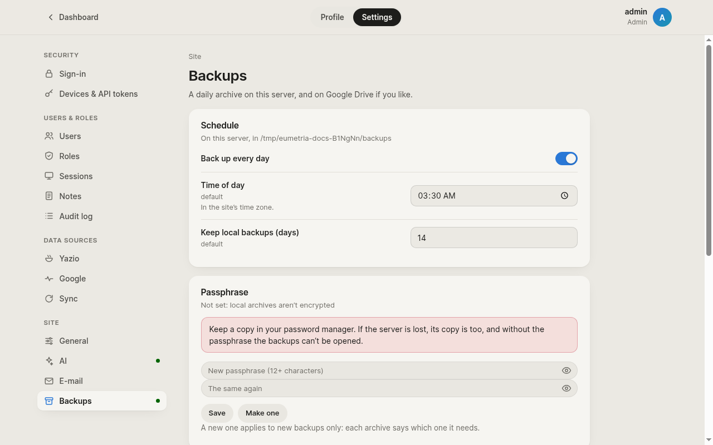

Every night at 03:30, Eumetria writes an archive to `/var/backups/eumetria` and keeps 14 days of them. An archive holds:

- the database (`app.db`): the synced history, accounts, settings, notes, trainings, lifts, check-ins and phases;
- meal and recipe photos, profile pictures and images in notes;
- the Google token.

Before every update from **Settings → Update**, by hand or at 04:00, Eumetria makes one more and waits for it: if it fails, nothing is installed. Its name is in the update's history, for going back after a version that changed the database (see [Updates and releases](/eumetria/operations/updates/#going-back)). It's kept like the nightly ones.

**Settings → Backups** changes the time and how long they're kept, shows the last runs and has **Back up now**. A backup doesn't run during a sync.



## Encryption and Google Drive

With a **passphrase** (set it in the same section, and keep a copy in your password manager), archives are encrypted. Then they can also go to **Google Drive**:

1. Enable the **Google Drive API** in the [Google Cloud project](/eumetria/connect/google-health/) you use for Fitbit data.
2. Turn **Also upload to Google Drive** on and save.
3. Under **Settings → Google**, use **Connect again** to allow it.
4. **Test connection**.

The app can only see and delete the files it made there. Without a passphrase, nothing is uploaded, and local archives are readable by root on the server.

:::danger[Keep SETTINGS_KEY]
`SETTINGS_KEY` isn't in the archives. Keep it with the passphrase: a restored server needs it to read its secrets, or they have to be typed in again and the authenticator apps set up again.
:::

## Restore

`<name>` is the archive, from the server or downloaded from Drive into `/var/backups/eumetria`. An archive ending in `.enc` is decrypted first; it asks for the passphrase.

```sh
cd /srv/eumetria
docker compose run --rm -it eumetria -decrypt-backup /backups/<name>.tar.gz.enc
docker compose down
mv data data.old
tar -xzf /var/backups/eumetria/<name>.tar.gz
chown -R eumetria:eumetria data && chmod 700 data
docker compose up -d
rm /var/backups/eumetria/<name>.tar.gz    # the decrypted copy
```

Archives from before November 2026 keep the synced history in `history.json`. Restored, the app imports it into the database at the next start and renames it to `history.json.imported-<date>`.
