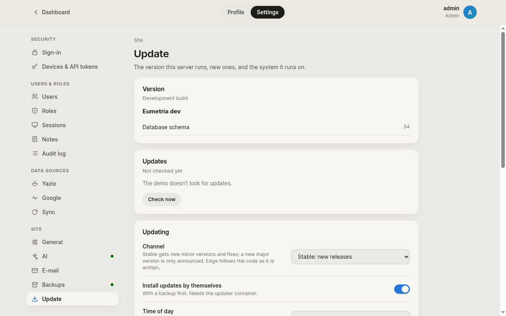

Eumetria tells an admin when there's a new version, shows what's new, and with the updater container installs it from the page: a backup first, then the new images, a health check, and the old version back if the new one doesn't come up. Like Home Assistant, without a cron job on the host.

## Settings → Update

Admins see a dot on **Settings → Update** and an **Update available** chip on Today when there's something to install. The section shows:

- the version that runs, its channel and image, and what's new in it;
- the last check and **Check now** (Eumetria looks once a day on its own);
- an available update with its release notes (stable) or the commits since the running one (edge), and **Install {version}**;
- the steps while it installs (Backup, Download, Restart, Health check), then "Waiting for Eumetria to come back…": the page reloads by itself on the new version;
- the last updates, each with its result and the backup made before it;
- the system: host name, the user it runs as, uptime, the database and its size.



Installing asks for your second factor again, as other changes to the server do. **E-mail me when an update is out** sends one mail per new version to your confirmed address (it needs [e-mail](/eumetria/security/sign-in/#e-mail) set up).

Checking asks GitHub's public API, without an account and without anything about you. If GitHub can't be reached, the section says "Couldn't check" and tries again the next day.

## Channels

| Channel | Tag | What you get |
|---|---|---|
| **Stable** (default) | `:1` | new 1.x releases, and the weekly security rebuilds |
| **Edge** | `:latest` | every commit on main whose tests passed |

The release tags are built again every Monday from the same code, so they get Go's and the base image's security fixes without a new release. Such a **security rebuild** isn't announced: it installs at the set time when automatic installs are on, and otherwise shows as "A security rebuild of this version is available".

Switching from edge back to stable can mean an older version than the one running. When that version doesn't know the database yet, the switch is refused and takes effect with the next release that has caught up.

The channel is kept as `EUMETRIA_TAG` in `/srv/eumetria/.env`, which the updater writes. `compose.yaml` uses it for all images (`…:${EUMETRIA_TAG:-1}`), so they stay on the same channel and a manual `docker compose up -d` keeps it.

## Automatic installs

**Install updates by themselves** is on by default: at 04:00 (**Time of day**, in the site's time zone) a new version or a security rebuild is installed the same way as with the button, backup first. A new major version never is.

## A new major version

A major version (`2.x`) means something needs doing when you update: a setting, the nginx configuration, a step by hand. It shows as a notice with its changelog section, "What to do for 2.0". After doing those steps, **Switch to 2** makes a backup and moves the channel to `2`. There's no way back to 1.x afterwards, other than the backup.

Once 2.0 is out, 1.x gets no more security rebuilds; the notice says so.

## The updater

`eumetria-updater` is a small container in [`compose.yaml`](https://github.com/eumetria-labs/eumetria/blob/main/deploy/compose.yaml). It's the only one with the Docker socket, which amounts to root on the host, so it's kept narrow:

- no ports, and no network except an internal one to Eumetria: it can't be reached from nginx or the host, and it can't reach out (the Docker daemon pulls the images, not the updater);
- it pulls and starts only `ghcr.io/eumetria-labs/eumetria`, `…-claude-runner` and `…-updater`, with the tag `latest` or a major number (`1`, `2`). A pinned tag or any other image is refused, even if Eumetria asked for one;
- Eumetria proves itself with a token the updater makes on its first start and shares through a volume. There's nothing to set up;
- it runs as root without capabilities, so `/srv/eumetria` and `.env` must belong to root (as [Install on a server](/eumetria/install/server/#1-user-and-folders) sets them up).

An update: tag the running images `:rollback`, pull the new ones, `docker compose up -d` (with `claude-runner` when its profile is in use), wait up to three minutes for Eumetria's health check. Healthy: done, and the updater replaces itself last. Not healthy: the old images are put back and started again, and the history says **Went back** with the end of the log.

Without the updater (plain `docker run`, the [Quick Start](/eumetria/start/quick-start/)), checking and the notification still work; instead of the button, Settings → Update shows the command to run.

## Going back

A database migration runs on the first start of a newer version. The updater's rollback covers a version that doesn't start; going back after the new version has migrated the database isn't always possible, because older versions don't know the newer tables. Then restore the [backup](/eumetria/operations/backups/#restore) made right before the update: its name is in the update's history.

## Pinning a version by hand

To hold one release, write its tag into `compose.yaml` instead of `${EUMETRIA_TAG:-1}` and leave the updater out (it refuses pinned tags):

| Tag | What you get |
|---|---|
| `:1.2` | the newest patch of 1.2: only fixes, no new features |
| `:1.2.3` | exactly that release |
| `:<commit>` | one build from main (`:3ba126d`), for going back on edge |

```sh
cd /srv/eumetria
# compose.yaml: image: ghcr.io/eumetria-labs/eumetria:1.2.3
docker compose pull && docker compose up -d
```

Which version runs: **Settings → Update**, or on the server

```sh
docker compose run --rm eumetria -version     # eumetria 1.2.3, or main-3ba126d on :latest
```

## Release notes

Each release's notes are on [GitHub Releases](https://github.com/eumetria-labs/eumetria/releases) and in [`CHANGELOG.md`](https://github.com/eumetria-labs/eumetria/blob/main/CHANGELOG.md); Settings → Update shows the same text.

## Making a release

For maintainers:

1. Move what's under `## [Unreleased]` in `CHANGELOG.md` to a new section `## [1.2.0] - <date>`, and add its link at the bottom.
2. Commit that on main and wait for CI to pass (including the updater's end-to-end test, `scripts/updater-e2e.sh`).
3. Tag and push:

   ```sh
   git tag -a v1.2.0 -m "Eumetria 1.2.0"
   git push origin main v1.2.0
   ```

The [release workflow](https://github.com/eumetria-labs/eumetria/blob/main/.github/workflows/release.yml) tests the tag, pushes the images (Eumetria, the Claude Code runner and the updater) as `:1.2.0`, `:1.2` and `:1`, and makes the GitHub release with that changelog section as its notes. If the section is missing, it stops before pushing anything. `scripts/release-notes.sh v1.2.0` shows locally what the notes will say.
