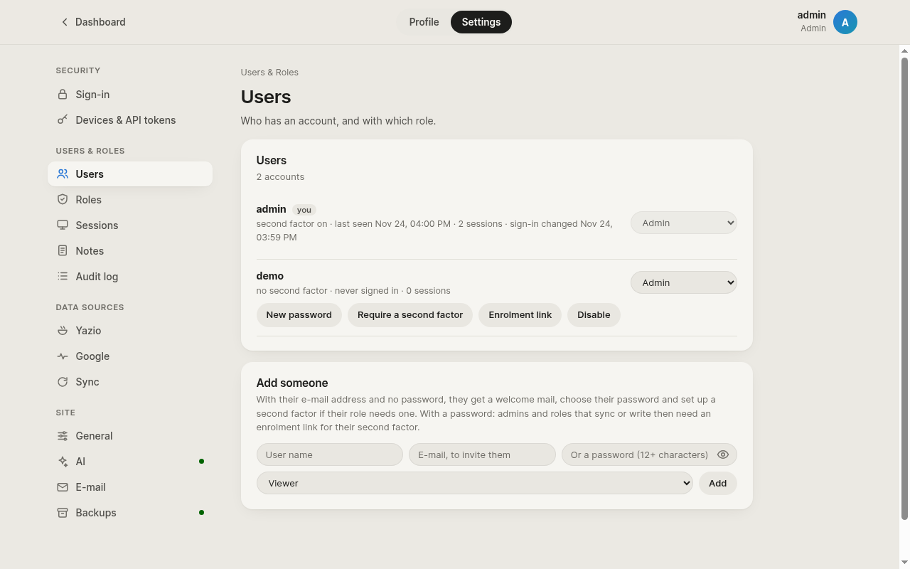
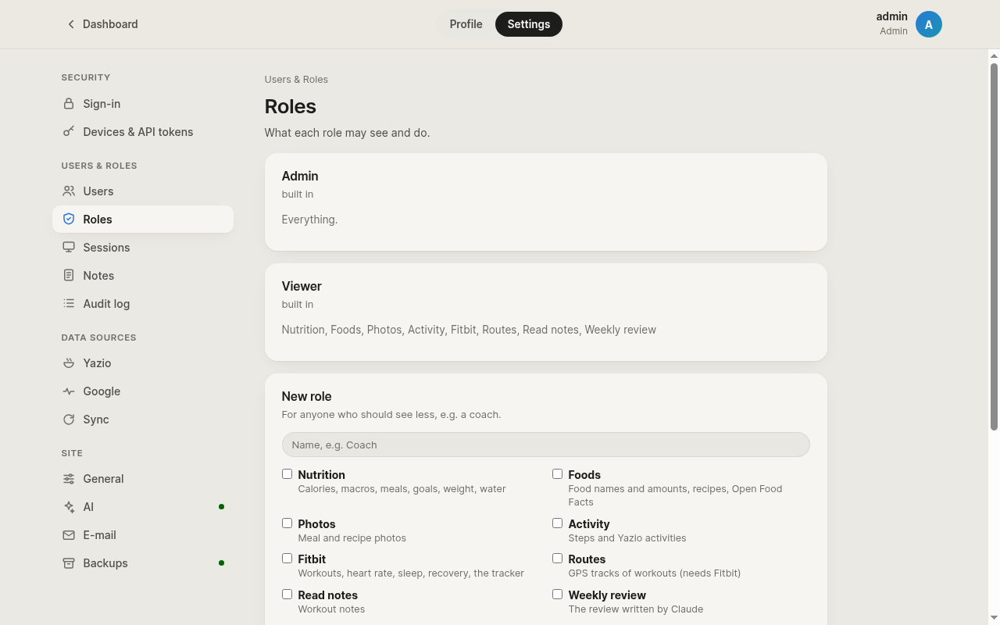

Everything but the sign-in page needs an account, and each account has one role. The server sends a user only the data their role allows; the page then hides what's empty.

## Permissions

| Permission | Gives |
|---|---|
| `view.nutrition` | calories, macros, meals, goals, weight, water |
| `view.foods` | food names and amounts, recipes, Open Food Facts data |
| `view.photos` | meal and recipe photos |
| `view.activity` | steps, Yazio activities |
| `view.health` | Fitbit workouts, heart rate, sleep, recovery, the tracker, trainings, lifts and benchmark workouts, check-ins |
| `view.routes` | GPS tracks of workouts (needs `view.health`) |
| `view.review` | the weekly review |
| `view.notes` | workout notes (needs `view.health`) |
| `edit.notes` | add, change and delete notes (needs `view.notes` and a second factor) |
| `edit.lifts` | trainings, personal bests (lifts and benchmark workouts), phases and events (needs `view.health` and a second factor) |
| `edit.checkin` | the daily check-in (needs a second factor) |
| `use.coach` | ask the coach |
| `sync` | the sync button, with **Full refresh** in its menu (needs a second factor) |
| `admin` | everything, including the admin tools, the audit log and the credit warning |

Two roles are built in: **admin** (everything) and **viewer** (every `view.*` permission). Make your own for anyone who should see less, e.g. a coach who sees what you eat but not where you run.

## In the page

Admins manage everything under **Settings → Users & Roles**:

- **Add people:** with a password, or (with [e-mail set up](/eumetria/security/sign-in/#e-mail)) with their address: they get a welcome mail, choose their password through its link (once, within three days), and set up a second factor right away if their role needs one.
- Give them a **role**; edit roles as checkboxes.
- Set a **new password** for someone who forgot theirs. That also ends their sessions and API tokens.
- **Require a second factor**: until they set one up, they see no data, only their own account settings.
- **Disable** an account and then **delete** it for good (what they wrote stays, without an author).
- End anyone's **session**, and read the **audit log**.

Changes need a recent proof of who you are: within 5 minutes of signing in, or the page asks you to confirm with a passkey, key or code from your app. You can't disable or demote your own account, and the site always keeps one admin. A changed role applies to the user's next request; they stay signed in.

## On the command line

For the first admin, or when nobody can sign in. With Docker Compose, on the server in `/srv/eumetria` (with the [Quick Start](/eumetria/start/quick-start/)'s `docker run`, use `docker exec -it eumetria /eumetria …` instead of `docker compose run --rm -it eumetria …`):

| Task | Command |
|---|---|
| Add someone | `docker compose run --rm -it eumetria -create-user <name>` (a viewer; `-role admin` or your own role) |
| Invite someone | `docker compose run --rm eumetria -create-user <name> -role <role> -email <address>`: a welcome mail instead of a password (needs e-mail, the public URL and `SETTINGS_KEY`) |
| Another role | `docker compose run --rm eumetria -set-role <name> -role <role>` |
| Roles, their permissions and users | `docker compose run --rm eumetria -list-roles` |
| Make or change a role | `-create-role <role> -scopes view.nutrition,view.foods`; again with new scopes to change it; `-delete-role <role>` once nobody has it |
| Forgotten password | `docker compose run --rm -it eumetria -reset-password <name>` (ends their sessions and API tokens too) |
| Every second factor lost, recovery codes too | `docker compose run --rm eumetria -reset-second-factors <name>`, then sign in with the password and set up new ones (with the enrolment link it prints, if the role needs a factor) |
| Enrolment link for the first second factor | `docker compose run --rm eumetria -enrol-link <name>` (add `-mail` to send it to their confirmed address) |
| Token for a script | `docker compose run --rm eumetria -create-token <name> -token-name cron -scopes sync -expires 365`, or **Settings → Devices & API tokens** |
