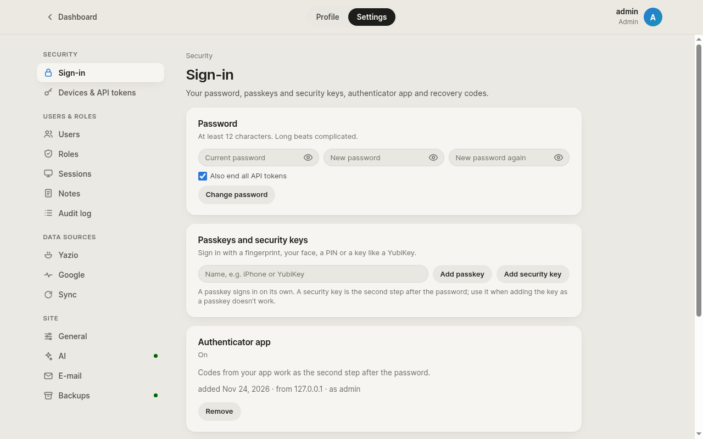

## Passwords and sessions

- **Passwords:** at least 12 characters, no common ones, stored as argon2id hashes. Change yours under **Settings → Sign-in**. That signs out your other devices and, unless you untick it, ends your API tokens. If you have passkeys that sign in on their own, you can remove them in the same step: do so if someone else may have had your account.
- **Sessions:** **Keep me signed in** lasts until a week without use, a month at most; without it, until the browser closes (12 hours at most). The account menu signs out here or everywhere.
- **What stays on the device:** only with **Keep me signed in** does the page keep your data for offline use. Signing out, or the session ending, deletes what was kept and tells the browser to drop its cache of the site. Photos, routes and year files are checked with the server on every load instead of being cached, so a later user of the same browser can't open them.

## Second factors

- **Passkeys** (fingerprint, face or PIN, synced by your phone or password manager) sign in on their own: from the button, or from the browser's suggestions in the name field.
- **Security keys** such as a YubiKey: **Add security key** registers a key only as the second step after the password, with nothing stored on it. Use it when a key can't take a passkey, e.g. a YubiKey through the CTAP proxy of Qubes OS.
- **Authenticator apps** (Google Authenticator, Aegis, 2FAS, Yubico Authenticator), and ten **recovery codes** for when the others are lost.

With one, the password is followed by a second step. **Admins, roles with `sync` and roles that write** (`edit.notes`, `edit.lifts`, `edit.checkin`) need one before they can sync, open the admin tools or write; a `sync` token stops working while its owner has none.

:::note
Passkeys only work on the real domain over HTTPS, and on `http://localhost` for trying it out, not on an IP address.
:::

### Enrolment links

The **first** second factor of an account that needs one is set up with an **enrolment link** (one use, 24 hours): **Settings → Users → Enrolment link** next to the user, or `-enrol-link <name>` on the command line; `-create-user` and `-reset-second-factors` print one. The password alone isn't enough, so someone who learned it can't make the account theirs by setting up their own factor first.

The same holds for promotions: when an account starts to need a second factor (a new role, more permissions for its role, or **Require a second factor**), the factors it set up without an enrolment link are removed, its sessions end, and the admin gets a new enrolment link to hand over.

Changing second factors, making recovery codes or API tokens, and changing the password of an account with a second factor ask you to confirm it's you (a passkey, key or app code; recovery codes don't count). **Sign-in** shows for each factor when, from where and under which role it was set up. Changes to how an account signs in show up as a notice for its user until they dismiss it.

## Wrong passwords

- Five wrong passwords in 15 minutes lock that account name for 15 minutes from that network (a /24, or a /64 for IPv6), doubling up to a day; twenty from one address lock the address. Wrong codes count the same.
- A name is never locked for everyone, so nobody can lock you out by typing your name: after more than 10 failures from anywhere, sign-ins for that name from browsers that never signed in to it run one at a time, slowed down, and share 20 tries an hour. Browsers you signed in with before aren't affected.
- 25 failures within 15 minutes show up in the audit log and, with a confirmed address, in a mail to the account's owner.
- Password checks need memory, so at most four run at once; more get "The server is busy" (HTTP 503) instead of piling up.

## E-mail

Optional. With a mail server under **Settings → E-mail** (or the `SMTP_*` [variables](/eumetria/install/configuration/)):

- Every change to how an account signs in (a key, an app, recovery codes, a token, the password, many failed sign-ins) also goes by mail to its owner, which someone holding their session can't dismiss.
- Admins hear when someone gets admin or sync rights or sets up a first second factor.
- Enrolment links and invitations can go by mail.

Mail goes only to an address its user confirmed with a link (**Profile → Account**), and only over an encrypted connection (STARTTLS on 587 or TLS on 465). There's no password reset by mail. Mail needs the public URL, since links in mails only ever point there.

:::caution[Sender address]
Use a sender address your mail provider may send for. With SPF and DKIM for its domain, Gmail and GMX refuse mail from anything else after the server accepted it: the log says "sent" and nothing arrives.
:::

## API tokens

Scripts use an API token instead of a password (**Settings → Devices & API tokens**). It carries permissions, `read` (the data the account's role sees), `sync` (if the role may sync) and/or `mcp` (only the [MCP server](/eumetria/connect/mcp/)), and an expiry. It's shown only once.

## Audit log

Kept for 180 days, at most 100,000 entries. Failed tries have their own limit (30 days, at most 50,000), so a flood of them can't push older security events out; repeated failed tries from one address count up in one entry. **Settings → Audit log** can show only the failed tries, or everything else.
