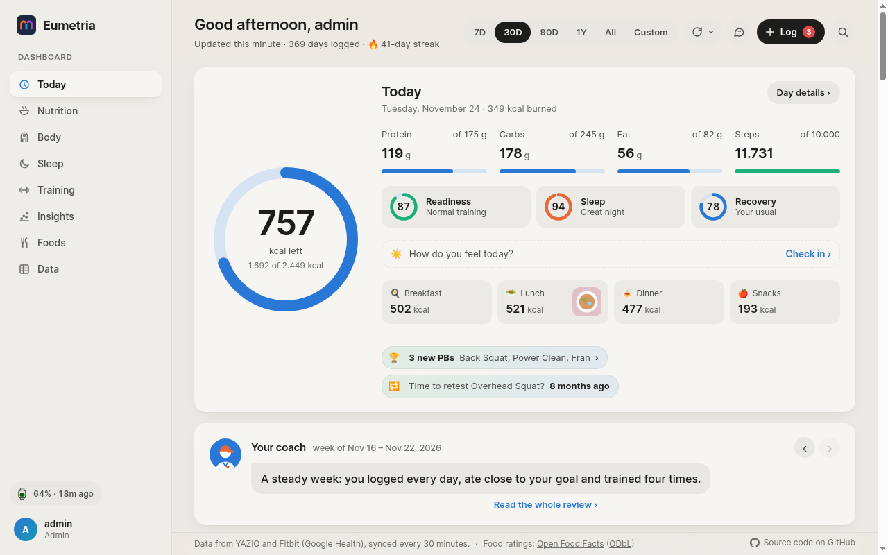
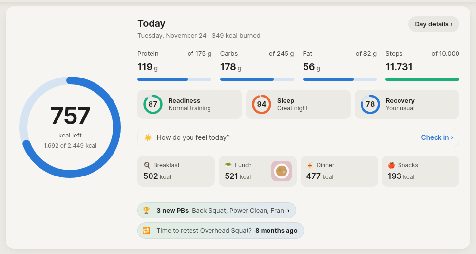
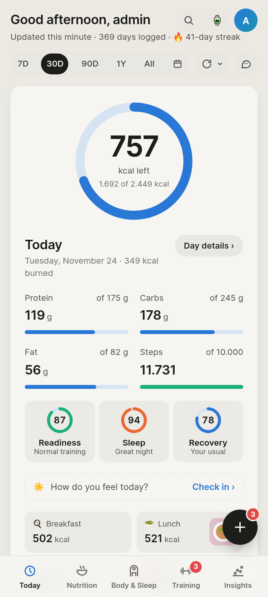
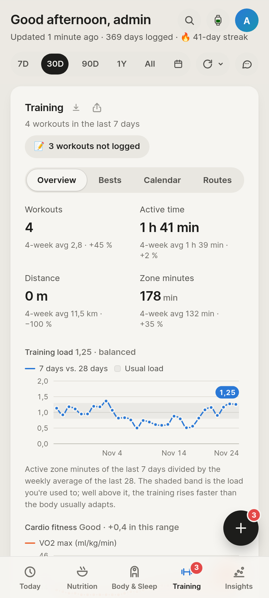
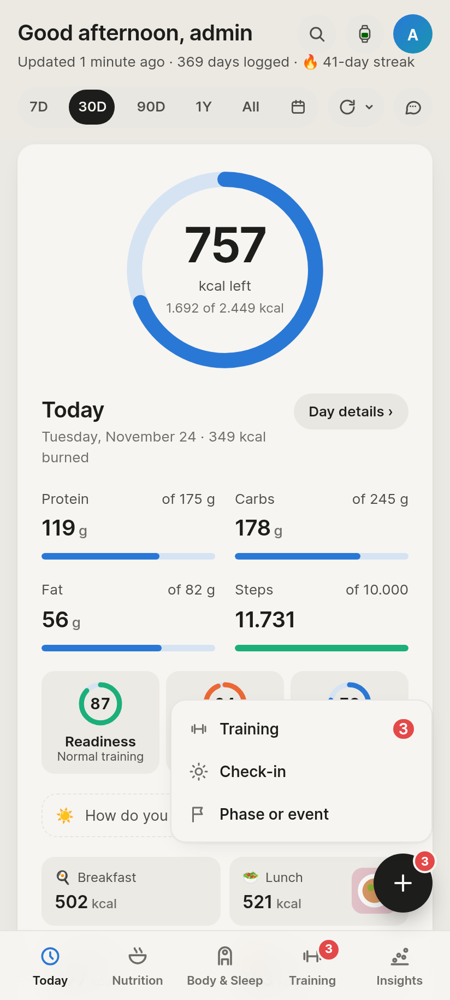

Once Yazio has synced, the page fills up. This is a short tour; the [Features](/eumetria/features/dashboard/) pages go into each part.

## The page

On a wide screen a sidebar lists the parts of the page: **Today, Nutrition, Body, Sleep, Training, Insights, Foods** and **Data**. The cards below follow the same order (you can change it, see [Customize Dashboard](/eumetria/features/dashboard/#customize-dashboard)).

At the top:

- **The range**: 7 days, 30 days, 90 days, a year, everything, or your own dates. Every card follows it.
- **Sync** (the round arrow): fetches the last days again. Its menu has **Full refresh** for the whole history.
- **Coach** (the speech bubble): a chat with Claude about your data, once it's [set up](/eumetria/connect/claude/).
- **+ Log**: log a training, a check-in, or a phase or event.
- **Search** (the magnifying glass, or Ctrl+K): foods, activities and days.

Your avatar, at the foot of the sidebar or top right on a phone, opens **Profile**, **Settings**, the style (light, dark or auto), the language and **Sign out**.

## The Today card

The ring shows the calories left for today, next to protein, carbs, fat and steps against your goals. Below are Eumetria's own **Readiness**, **Sleep** and **Recovery** scores (with a Fitbit or Pixel Watch), the daily check-in, the meals, and chips for new personal bests and other highlights. **Day details** opens the day's window with every food, activity and the night's sleep.

## On a phone

On a phone the page shows one part at a time, with a tab bar at the bottom: **Today, Nutrition, Body & Sleep, Training** and **Insights**. The round **+** above it logs things. Install it from the browser's menu (**Add to Home screen** or **Install app**) to get it as an app with its own icon; see [On your phone](/eumetria/features/phone/).

## Next

- Add [Fitbit or Pixel Watch](/eumetria/connect/google-health/) data for workouts, sleep and the scores.
- Let [Claude](/eumetria/connect/claude/) write a weekly review, answer questions, and read whiteboard photos.
- Add people with their own roles: [Accounts and roles](/eumetria/security/accounts/).
