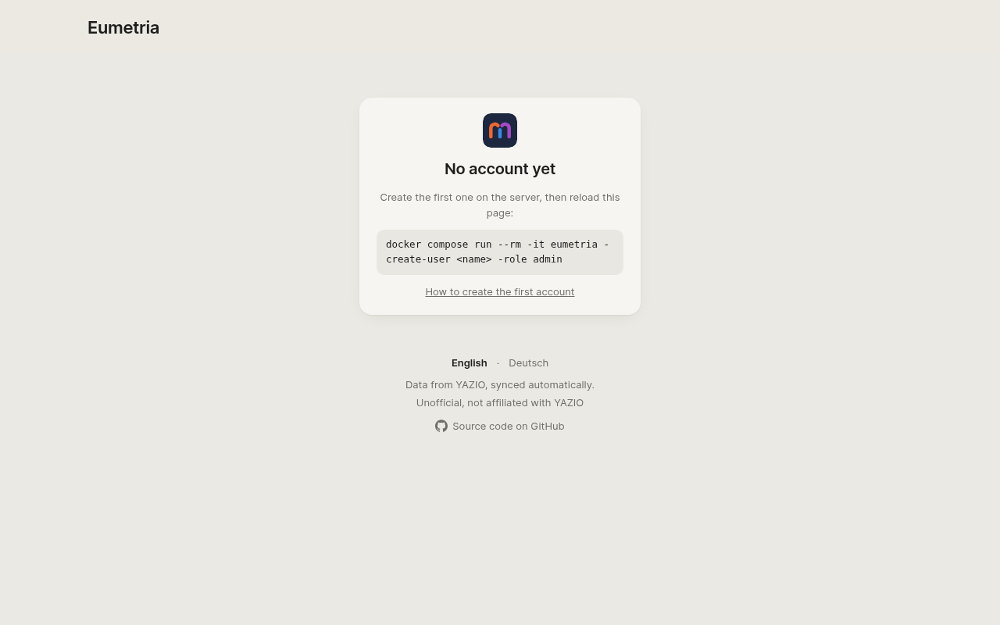
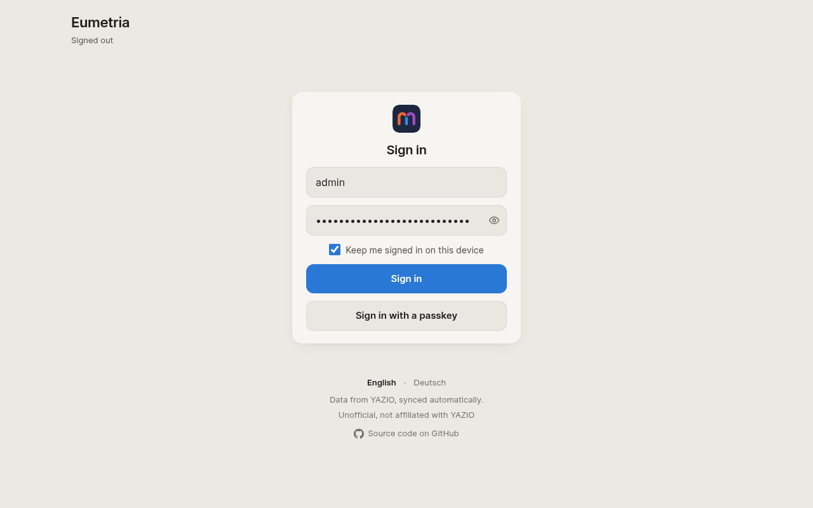
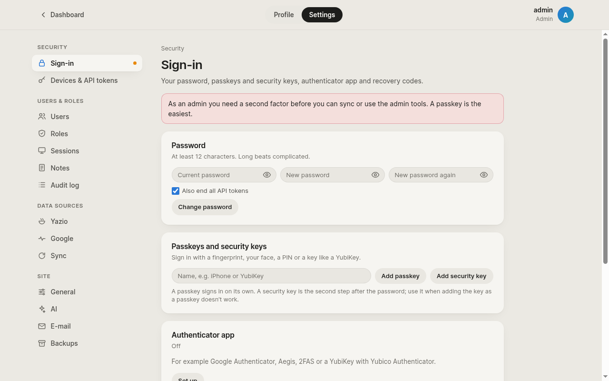
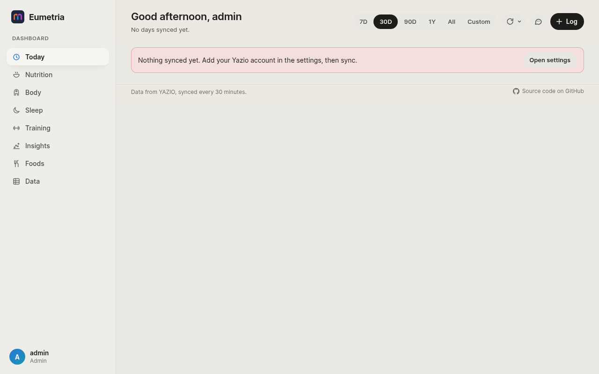
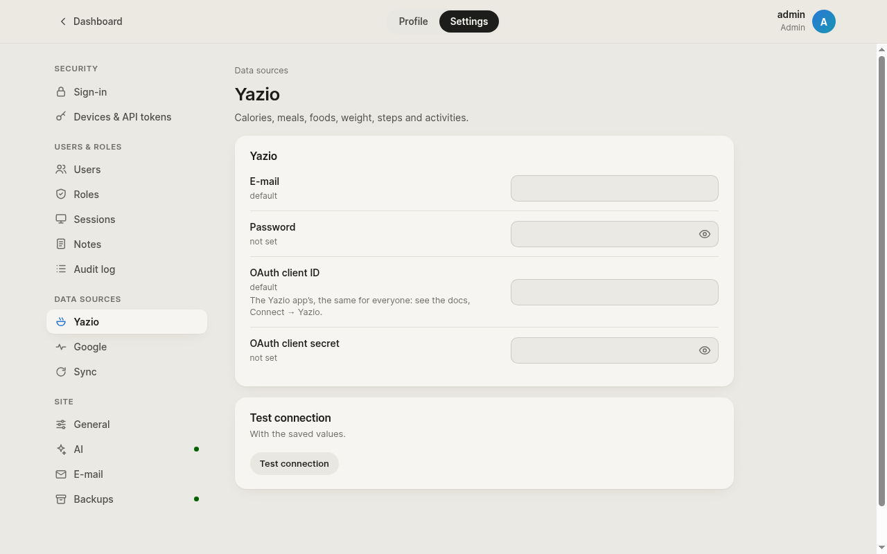

This gets Eumetria running on your own computer in a few minutes, to try it out. For a server that stays up, with HTTPS and backups, follow [Install on a server](/eumetria/install/server/) afterwards.

You need [Docker](https://docs.docker.com/get-docker/) and a terminal.

## 1. Start the container

```sh
echo "SETTINGS_KEY=$(openssl rand -hex 32)" > eumetria.env
docker run -d --name eumetria \
  -p 127.0.0.1:8080:8080 \
  -v eumetria-data:/data \
  --env-file eumetria.env \
  -e PUBLIC_URL=http://localhost:8080 \
  -e TZ=Europe/Berlin \
  ghcr.io/eumetria-labs/eumetria:latest
```

- `eumetria-data` is a Docker volume that keeps the database, photos and settings.
- `SETTINGS_KEY` encrypts the secrets you enter later (your Yazio password, for example). Keep `eumetria.env`: without the key those secrets can't be read again.
- Set `TZ` to your time zone.

Check that it runs:

```sh
docker logs eumetria
# … no account yet: create the first with -create-user <name> -role admin …
# … serving compiled-in page files on :8080, syncing every 30m0s
```

The log also says the sync failed because no Yazio account is set up yet. That's expected at this point.

## 2. Open the page

Open `http://localhost:8080` in your browser. Until an account exists, the page only says how to make one:



:::note[Use localhost]
Eumetria's sign-in cookie only works over HTTPS, or over plain HTTP on `localhost`. To try it on a remote machine, forward the port over SSH (`ssh -L 8080:localhost:8080 you@server`) and open `http://localhost:8080` on your computer, or set it up properly with [nginx and HTTPS](/eumetria/install/server/).
:::

## 3. Create the first admin

```sh
docker exec -it eumetria /eumetria -create-user admin -role admin
```

It asks for a password twice: at least 12 characters, and common ones are refused. Then it prints an **enrolment link**:

```text
Created admin (admin). Sign in at the site.

admin needs a second factor and can set up the first one only with this link (once, until …):

http://localhost:8080/#enrol=tHlpD7YtKlHrT3opmzFwQ9z3r8LdtqDb-Gq06TjAKCo
```

An admin needs a second factor (a passkey or an authenticator app), and the first one can only be set up through this link. It works once, for 24 hours. Lost it? `docker exec eumetria /eumetria -enrol-link admin` makes a new one.

## 4. Sign in and set up the second factor

Open the enrolment link and sign in with the name and password:



The page opens **Settings → Sign-in**. Add a **passkey** (your fingerprint, face or device PIN, works on `localhost` too) or set up an **authenticator app** such as Google Authenticator, Aegis or 2FAS:



Once the second factor is set up, the dashboard opens. It's empty for now:



## 5. Connect Yazio

Press **Open settings**, or go to your avatar → **Settings → Yazio**, and enter your Yazio e-mail and password and the Yazio app's OAuth client ID and secret. [Yazio](/eumetria/connect/yazio/) explains where those come from.



**Test connection**, save, then press the sync button next to the range. The first sync fetches a year of history and every meal photo, which takes a few minutes.

## Just looking?

To see Eumetria with sample data and without any accounts of your own, start it in demo mode and sign in as `demo` / `demo`:

```sh
docker run --rm -p 127.0.0.1:8080:8080 ghcr.io/eumetria-labs/eumetria:latest -demo -serve :8080
```

## Next steps

- [First steps](/eumetria/start/first-steps/): a short tour of the page.
- [Fitbit and Pixel Watch](/eumetria/connect/google-health/): workouts, sleep and recovery.
- [Install on a server](/eumetria/install/server/): HTTPS, a dedicated user, updates and backups.

To remove the try-out: `docker rm -f eumetria && docker volume rm eumetria-data`.
